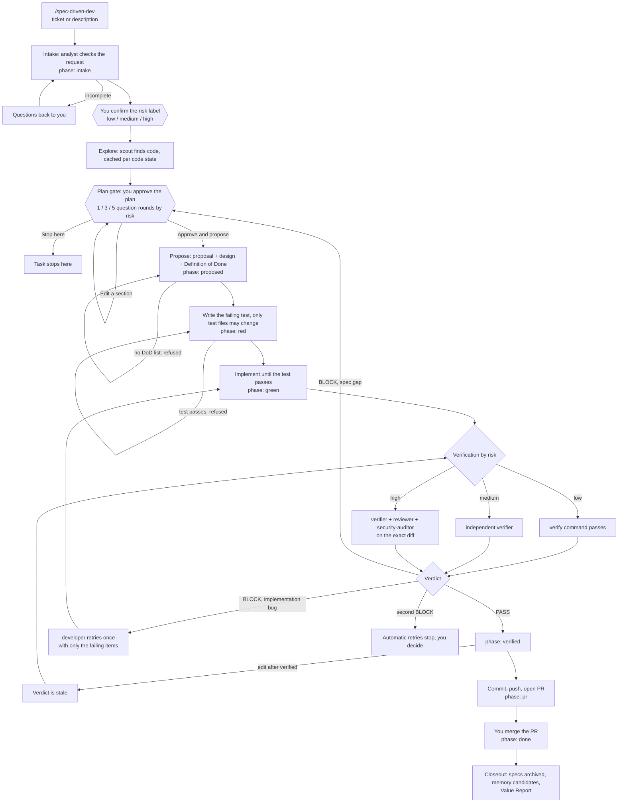

# SDKit — spec-driven development for AI coding agents

**Make your coding agent follow a real engineering process, enforced by scripts instead of left to its good intentions.**


SDKit (`spec-driven-kit`, command `sdkit`) turns "ask the agent to build it" into a gated workflow:
**plan → proposal with a Definition of Done → failing test → implementation → independent verification → PR.**
A phase machine blocks the shortcuts (code before a plan, push before verification), and a separate verifier agent, not the one that wrote the code, decides whether the work is done.

It runs on **Claude Code, Codex, OpenCode, Cursor and Gemini CLI** ([supported agents](#supported-agents)), on **Go, Spring Boot / JVM, Python, Next.js, React Native** or any other stack ([supported stacks](#supported-stacks)), and it carries **no project facts**: each repo brings its own risk rubric, rules and checks.

## Why

AI agents are fast, but left alone they skip steps, mark their own homework and drift from the spec. Prompts that ask them to behave are only suggestions. SDKit makes the process a mechanism:

- **The author never signs off.** For medium and high risk, a verifier that never saw the implementation reasoning checks the diff against the Definition of Done.
- **Order is enforced.** Hooks, git hooks and CI all ask the same rule: no code before a proposal and a failing test, no push or PR before verification, and any edit after verification makes the verdict stale.
- **Risk sets the rigor.** Low is one session. Medium adds a mandatory verifier. High splits test writer, implementer and verifier into separate agents and freezes the regression test.
- **You stay in control.** You confirm the risk label and approve the plan before anything is proposed. Incidents become guards (`incident-to-rule`).
- **Cost is measured, not promised.** A usage ledger, budgets and a Value Report show tokens and cost per task, and print `N/A` where records are missing.

## What you get

| Area | Plain agentic development | With SDKit | Evidence |
|---|---|---|---|
| **Token use** | One strong model reads, searches and re-reads in a growing context | Tiered models, short handoffs, cached verification and scouting, budgets | **~70% lower total token use**, measured by the maintainer on their own workloads |
| **Cost** | Top-tier model for every step | Cheap tier for search and planning checks, strong tier only for design and high-risk verification | Estimated against a stated baseline in the Value Report |
| **Time** | Sequential work in one session; rework after review finds missed requirements; repeated test runs | Independent tasks run as parallel subagents in separate worktrees, orchestrated by roles; gaps caught at intake; no repeated work on an unchanged tree | **~40% less wall-clock time**, measured by the maintainer on their own workloads |
| **Efficiency and quality** | The author reports "done" | Verifier checks the diff against the Definition of Done; stale verdicts are refused after any edit | Enforced by the phase gate; `sdkit report task` shows the verdict |
| **Team work** | Every developer prompts differently | One committed `.sdkit/` (risk rubric, rules, checks) gives everyone, on any supported agent, the same process, with the same CI gate | Enforced by hooks, git hooks and CI |
| **Visibility** | A chat log | Phase, evidence, tokens and cost on demand; per-task Value Report | Local records, no model call |

The ~70% (tokens) and ~40% (time) figures are a single maintainer's measurements, not benchmarks: results depend on task mix, model and stack. Measure your own with `sdkit report task <task>`, which prints `N/A` rather than a guess where records are missing. Method and caveats: [docs/design-report.md](docs/design-report.md).

## How it works

You give the agent a task. SDKit moves it through a **phase machine** (`scripts/sdd.sh`). Each move has an exit condition that a script checks, so the agent cannot skip a step by deciding it is not needed. The path is not a straight line: some steps loop, some branch by risk, and failures have defined exits.



Gate phases: `intake → proposed → red → green → verified → pr → done` (plus `aborted`). Specification and planning both happen inside `intake`.

### Step by step

| Step | Phase | What happens | It moves on when |
|---|---|---|---|
| **Intake** | `intake` | The `analyst` checks that the request is complete and proposes a risk label from your `project.md` rubric | You confirm the label |
| **Explore** | `intake` | `scout` answers "where is X" cheaply; answers are cached per code state | The problem is grounded in code |
| **Plan gate** | `intake` | For medium/high the `engineer` drafts design, test strategy and task split. You are questioned on the plan in batched rounds (1 low, 3 medium, 5 high) | You pick `Approve and propose` |
| **Propose** | `proposed` | `plan.md` becomes `proposal.md`, `design.md`, `specs/`, `tasks.md`. Every acceptance criterion is a testable line `D<n>: ... \| Verified by: ...` | `advance proposed` finds a Definition of Done list (high: also a race/ordering section) |
| **Test first** | `red` | `test-writer` writes the failing test. Only test files may change | `advance red` runs the test and it **fails** |
| **Implement** | `green` | `developer` writes code until the test passes. Independent tasks (disjoint `writes:`) run as parallel subagents in separate worktrees | `advance green` runs the test and it **passes** |
| **Verify** | `verified` | Depends on risk (see below). Evidence is tied to the exact diff | A PASS for this diff |
| **PR** | `pr` | Commit, push and open the PR. Push is denied before `verified` | `advance pr` |
| **Closeout** | `done` | After you merge: specs synced and archived, memory entries you pick, Value Report written | `advance done` |

### When it is not a straight line

| Situation | What SDKit does |
|---|---|
| Request is incomplete | The analyst sends questions back; nothing is proposed until the brief is complete |
| You want to change the plan | `Edit a section` re-runs only the affected rounds; `Stop here` ends the task |
| Proposal has no Definition of Done | `advance proposed` is refused with the reason; fix and retry |
| Test passes before any code exists | `advance red` is refused: the test must fail, for the right reason |
| Tasks overlap or depend on each other | `after:` links order them; tasks with overlapping `writes:` never run in parallel (`plan-waves.sh` computes the waves) |
| Verifier `BLOCK`, implementation bug | One automatic retry with only the failing items |
| Verifier `BLOCK`, spec gap | Back to the plan gate. No retry against a broken target |
| Second `BLOCK` | Automatic retries stop and you decide. No third loop |
| Code edited after verification | The verdict is stale; push and PR are refused until you verify again |
| Valid evidence already exists for this diff | With `ROUTING=on` it is reused and nothing runs again |
| Budget would be exceeded | Stops before the spawn that goes over; you continue, raise the limit or stop. Verification is never shortened |
| Session crashed or was killed | Records stay on disk; `recover.sh scan` and `state.sh <task> show` resume the task |
| You abandon the task | `sdd.sh abort` ends it and still writes the report |

Every box above maps to a real mechanism. Real command output for each step: **[docs/developer-workflow.md](docs/developer-workflow.md)** §5 and §10.

### Risk decides the rigor

| Risk | What happens |
|---|---|
| `low` | DoD → RED → implement → GREEN → PR. No separate verifier |
| `medium` | Same, plus a **mandatory independent verifier** before the PR |
| `high` | Race/ordering scenario in `design.md`; one agent writes and freezes a regression test against real infrastructure, another implements, a third verifies; plus code and security review |

A verifier `BLOCK` gets one automatic retry; a second stops and hands the decision to you.

### Roles

Your session is the *orchestrator*. It hands narrow jobs to *roles*, each run a fresh agent. Roles declare a cost tier, never a model name.

| Role | Job |
|---|---|
| `analyst` | Every task: is the request complete, what risk |
| `engineer` | Design and test strategy for medium/high (designs, never implements) |
| `test-writer`, `developer`, `devsecops` | Tests, code, pipelines |
| `verifier` | Medium/high: checks the diff against the DoD. Read-only |
| `reviewer`, `security-auditor` | Required at high (security-auditor also for pipeline/infra). Read-only |

## Token and cost control

Agent workflows spend most of their tokens on searching, re-reading and long contexts. SDKit keeps that in check and measures it, so you decide from numbers instead of guesses. The limits are empty by default; the kit imposes none of its own.

| Lever | How it works |
|---|---|
| **Model tiers** | Roles declare a cost tier, never a model name: `light` (search, planning check), `standard` (most work), `strong` (design, high-risk verification). `core/tiers.env` maps tiers to models, e.g. `haiku` / `sonnet` / `opus` on Claude Code. Independent roles never drop below their own tier |
| **Right-sized work** | Each task in the plan gets a `size`, which picks the tier. You can change it at the plan gate. Low risk skips the engineer, the independent verifier and parallel waves |
| **Subagents keep context small** | A role gets a short handoff with file paths, not the conversation. It returns at most 15 lines and files the long form under `work/<slug>/out/`. Roles never spawn roles, and one- or two-file work stays in the main session |
| **Context growth** | `SKILL.md` is short and step detail loads only when needed. Command output is trimmed to a summary plus failing lines (`capped.sh`). Progress is checkpointed so `/clear` or compaction loses nothing |
| **Cheap before expensive** | `verify.sh` runs before the LLM review; plan parity, verdict parsing, write-set and retry checks are scripts, not model calls. Green verification is cached per code state and scout answers per question |
| **Cache hit ratio** | Handoffs put fixed lines first and changing lines last, tasks in a wave share a model and spawn together, so the prompt cache keeps hitting. `usage.sh report` prints the hit rate |
| **Budgets** | `MAX_SPAWNS` and `TOKEN_BUDGET_TASK` stop and ask before the spawn that goes over (`strict`) or only warn (`guided`). A budget stop never shrinks verification |
| **Routing** (`ROUTING=on`) | A deterministic function, with no model call, decides which adapter and model run a role and whether to run, reuse valid evidence, retry or escalate. Risk floors and mandatory gates are never lowered |
| **Local measurement** | `USAGE_LOG=1` writes a per-run ledger (role, tier, model, input, output, cache tokens). `TELEMETRY=1` records phases, agent runs, retries and failures as local events. Nothing leaves your machine and no prompts are logged |
| **Honest numbers** | Every figure is labelled actual, estimated or unavailable. Where a host reports no token usage the ledger stays empty and budgets stay silent; the kit does not guess |

Read the result with `usage.sh report <task>` for tokens, cache hit rate and budget, or `sdkit report task <task>` for the Value Report: per-role tokens, API-equivalent cost and savings against a stated baseline. Orchestration adds agent runs, so SDKit does not assume it saves money; it reports only what the records support. Details: [guide §18](docs/guide.md), [design-usage.md](docs/design-usage.md), [design-routing.md](docs/design-routing.md), [design-telemetry.md](docs/design-telemetry.md).

## Quick start (macOS)

**1. Install the kit, once per machine**

```sh
brew tap wecii/sdkit https://github.com/wecii/sdkit.git
brew trust wecii/sdkit      # recent Homebrew asks for this once
brew install sdkit          # brings jq and node
```

No Homebrew? Clone this repo and use `<kit>/bin/sdkit` the same way. Maintainers: [packaging/homebrew/README.md](packaging/homebrew/README.md).

**2. Set a repo up, once, by one person**

```sh
cd your-repo
sdkit init                  # Claude Code by default; --host codex | opencode | cursor | gemini | claude,codex,...
```

`init` detects the stack and base branch, writes the project profile, installs the host files and sets up OpenSpec, the spec engine the workflow drives (`--install-openspec` installs its CLI if missing). Then:

1. Fill in `.sdkit/project.md`. **The risk rubric is mandatory**; the workflow will not start without it.
2. Enable the `verify.d/` policies you want (rename `*.example` to `*.sh`). Team settings live in `.sdkit/sdkit.env` (committed); your personal ones in `.sdkit/sdkit.local.env` (not in git). Every setting is already there with its default.
3. Run `sdkit doctor` and fix every `FAIL`.
4. Commit `.sdkit/`, `AGENTS.md` and the kit block in `.claude/CLAUDE.md`. Add `--ci github`, `--ci gitlab` or `--ci bitbucket` to install the server-side gate too.

**3. Join, every other developer** (install sdkit on your machine; host files are generated per machine and hidden from git)

- **Claude Code:** run `claude` and accept the plugin prompt once.
- **Codex, OpenCode, Cursor, Gemini:** `git config core.hooksPath .githooks` once per clone.

**4. Start a task**

| Host | Command |
|---|---|
| Claude Code | `/spec-driven-dev <ticket or description>` |
| Codex | `$spec-driven-dev <ticket or description>` |
| OpenCode, Cursor, Gemini | ask the agent to use the `spec-driven-dev` skill on the task |

**Updating:** `brew upgrade sdkit`, then `sdkit upgrade` in each repo (and refresh the plugin in Claude Code with `/plugin`). It adds what is new and never touches your files. Manual steps per version: [docs/upgrading.md](docs/upgrading.md).

## Where am I?

There is no dashboard; these read-only commands answer it (`KIT="$(sdkit where)"`, run inside your repo):

| Question | Command |
|---|---|
| Phase and active task | `$KIT/scripts/sdd.sh status` → `task=rate-limit risk=medium phase=green` |
| Which verifier / reviewer / auditor PASS is missing | `$KIT/scripts/sdd.sh evidence` |
| What the task requires, what each move needs | `$KIT/scripts/sdd.sh policy`, `sdd.sh transitions` |
| Why was I stopped | the refusal message names the missing step; `sdd.sh gate edit <path>` re-asks |
| Tokens, cache, cost, budget | `$KIT/scripts/usage.sh report <task>`, `usage.sh budget` |
| Result of a task | `sdkit report task <task>` |

More in [docs/developer-workflow.md](docs/developer-workflow.md) §7 and the one-page [docs/cheatsheet.md](docs/cheatsheet.md).

## How it is enforced

| Layer | Where | What it stops |
|---|---|---|
| Phase gate | `scripts/sdd.sh gate`, the single decision point | code before a proposal and a failing test; push/PR before verification; any edit after verification |
| Agent hooks | Claude Code (full set), Gemini/Cursor/OpenCode (adapters) | the above per tool call, plus secrets, protected paths, frozen tests, prod `kubectl`, release-flow git mistakes |
| Git hooks | `.githooks/`, every tool | the same gate at commit and push time |
| CI | `sdkit init --ci ...` | a PR whose code change has no committed attestation for exactly that diff; medium/high also need a verifier PASS. The job runs the **base branch's** `sdd.sh`, so a PR cannot edit the check that judges it |

`SDD_MODE` in `sdkit.env`: `strict` (default) denies, `guided` asks or warns, `off` disables. Git hooks can be skipped with `--no-verify`; CI cannot, so mark the CI check as required. Details: [docs/guide.md](docs/guide.md).

## Optional features

Configured in `.sdkit/sdkit.local.env`. Cost, budget, routing and telemetry features are covered in [Token and cost control](#token-and-cost-control).

| Feature | What it gives you | Details |
|---|---|---|
| **Memory** (`MEMORY=1`, on) | Durable facts and decisions in `.sdkit/memory/`, one index line each, shared through git | [guide §19](docs/guide.md) |
| **Workflow profiles** | `sdd.sh start --profile small\|standard\|high-assurance`: process weight, separate from risk. A profile never removes a gate | [design-workflow.md](docs/design-workflow.md), [design-evidence.md](docs/design-evidence.md) |
| **Agent contracts** (`CONTRACTS=1`) | Checked handoff and result lines between orchestrator and roles | [design-contracts.md](docs/design-contracts.md) |
| **Benchmarks** | `bench/run.sh` simulates four workflows for free; a task-level benchmark compares plain agentic development with SDKit | [design-benchmark.md](docs/design-benchmark.md) |

## Who edits what

You never edit the kit. You edit your own repo, and the kit writes only its own part of any shared file.

| In your repo | Owner |
|---|---|
| `.sdkit/project.md`, `rules/`, `verify.d/`, `memory/`, `roles.d/`, your own skills and agents | **You**, shared by the team via git; the kit never touches them after creation |
| `.sdkit/sdkit.env` | **Team**: committed policy; the kit only appends new settings |
| `.sdkit/sdkit.local.env` | **Each developer**: personal, not in git, wins over `sdkit.env` |
| `AGENTS.md`, `CLAUDE.md`, `.codex/config.toml`, `.cursor/hooks.json`, `.gemini/settings.json` | **Shared**: the kit owns only its marked `spec-driven-kit:begin … end` block or its own keys |
| kit scripts, hooks, role files, `.githooks/`, `settings.local.json` | **Kit**: generated per machine, hidden from git, refreshed by `sdkit sync` |

To adapt a role, write `.sdkit/roles.d/<role>.md`. `sdkit sync --check` and `sdkit doctor` report drift. Full ownership table: [docs/guide.md](docs/guide.md) §3.

## Supported agents

Roles are written once in `core/roles/` and generated for each host. Every agent gets the workflow skill, the role files and the git-hook gate; the strength of the in-session guard differs.

| Agent | Install | Start a task | In-session guards | Status |
|---|---|---|---|---|
| **Claude Code** | `sdkit init` (default) | `/spec-driven-dev` | hooks the model cannot skip, as a plugin | Validated on live installs |
| **Codex** | `--host codex` | `$spec-driven-dev` | sandbox `read-only` for read-only roles + git hooks | Follows documented format |
| **OpenCode** | `--host opencode` | ask for the `spec-driven-dev` skill | JS plugin + git hooks | Follows documented format |
| **Cursor** | `--host cursor` | ask for the `spec-driven-dev` skill | `hooks.json` + git hooks | Follows documented format |
| **Gemini CLI** | `--host gemini` | ask for the `spec-driven-dev` skill | `settings.json` hooks + git hooks | Follows documented format |

Mix hosts with `--host claude,codex`. Any agent that reads `AGENTS.md` and runs shell commands still gets the phase gate through git hooks and CI, and `run-role.sh` can run the verifier in a different provider for real independence. Per-host details and limits: [docs/guide.md](docs/guide.md) §16.

## Supported stacks

`init` detects the stack and wires in its verify commands (format, lint, test, build), permissions, rules and known pitfalls. One stack per repo.

| Stack | Detected by | |
|---|---|---|
| **Go** | `go.mod` | `go` |
| **Spring Boot** | Maven/Gradle build that uses Spring Boot | `spring-boot` |
| **JVM** | any other `pom.xml`, `build.gradle(.kts)` | `jvm` |
| **Python** | `pyproject.toml`, `setup.py`, `requirements.txt` | `python` |
| **Next.js** | `next` in `package.json` | `nextjs` |
| **React Native** | `react-native` in `package.json` | `react-native` |
| **Anything else** | fallback: you supply the verify commands | `generic` |

Adding a stack: [stacks/README.md](stacks/README.md).

## Requirements and pull requests

- `git`, `jq`, `node` (for OpenSpec) and your stack's toolchain. `sdkit doctor` lists what is missing. macOS and Linux; Windows is not supported (the kit is bash).
- Pull requests: Bitbucket (REST API), GitHub (`gh`) and GitLab (`glab`). `PR_HOST=auto` picks one from the origin URL ([docs/hosts.md](docs/hosts.md)).
- `<project-dir>` is `.sdkit/` for every host. Repos set up before 1.0 keep their old directory until `sdkit upgrade --migrate`.

## Analyst and developer environments

`sdkit init --env analyst|developer` picks an experience; without it nothing changes (`SDKIT_ENV=standalone`, the workflow above).

- **analyst** (a specs repo): `/generate-specs` turns a pre-spec into a reviewed spec PR, `/update-specs` changes an approved one, `/generate-tasks` writes Jira subtasks from it. The Tech Lead approves by merging.
- **developer** (a source repo): `/spec-driven-dev PROJ-123` runs the same phases and gates, but the task and its pinned spec revision come from Jira.

```
sdkit init --env analyst    # then: /generate-specs onboarding
sdkit init --env developer  # then: /spec-driven-dev PROJ-123
```

Seven skills and eleven roles ship in this version. Flows, limits and open decisions: [docs/role-aware.md](docs/role-aware.md).

## The `sdkit` command

| Command | Does |
|---|---|
| `sdkit init [options] [dir]` | Set a repo up (profile, host files, OpenSpec, optional CI) |
| `sdkit doctor [dir]` | Check a repo and say what to fix |
| `sdkit sync [--check] [dir]` | Refresh the kit's files; `--check` only reports drift |
| `sdkit upgrade [dir]` | Bring a repo to the installed kit version |
| `sdkit install` | Register a cloned kit on the machine for the git hooks (not needed with Homebrew) |
| `sdkit report task\|session\|latest\|history` | The Value Report |
| `sdkit version`, `sdkit where` | Version, and where the kit lives |

## Limits

- Guards are regex-based safety nets, not a security boundary. They keep a cooperative agent on the workflow; an agent that tries to get around them can (Bash writes are not phase-gated).
- An attestation is a JSON file the author commits: `ci-check` proves the flow was run for exactly this diff, not who ran it or that the verifier was independent. Protect `.sdkit/`, `attestations/` and the CI file with CODEOWNERS.
- One stack per repo.
- `spec-driven-dev` drives the OpenSpec skills, so the `openspec` CLI is required.

## Documentation

| Read | When |
|---|---|
| [docs/README.md](docs/README.md) | Not sure where to start |
| [docs/developer-workflow.md](docs/developer-workflow.md) | The whole developer journey, from init to Value Report |
| [docs/role-aware.md](docs/role-aware.md) | Analyst and developer environments, Jira tasks |
| [docs/cheatsheet.md](docs/cheatsheet.md) | One-page daily reference |
| [docs/guide.md](docs/guide.md) | Every skill, role, hook, setting, install flow and limit |
| [docs/upgrading.md](docs/upgrading.md) | Updating projects between kit versions |
| [docs/hosts.md](docs/hosts.md) | Pull-request host setup |
| [stacks/README.md](stacks/README.md) | What a stack provides |
| [core/roles/README.md](core/roles/README.md) | Role format and roster |
| [CONTRIBUTING.md](CONTRIBUTING.md) | Changing the kit itself, adding a hook or stack, releasing |

## License

[MIT](LICENSE)
