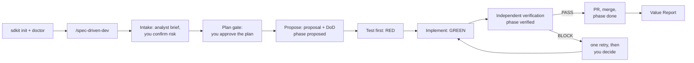

# spec-driven-kit (`sdkit`)

A development process for AI coding agents, enforced by tooling instead of left to the agent's good intentions.
It works with **Claude Code, Codex, OpenCode, Cursor and Gemini CLI**, on any stack.

```
task ─► analyst (is it complete?) ─► risk label (you confirm) ─► explore
     ─► plan gate (you approve the plan) ─► proposal + Definition of Done
     ─► test first (RED) ─► implement (GREEN) ─► independent verification ─► PR ─► closeout
```

What it guarantees:

1. **The agent that writes the code cannot declare it done.** For medium and high risk a separate verifier, which never saw the
   implementation reasoning, checks the diff against the Definition of Done.
2. **The order is a mechanism, not a reminder.** A phase machine (`scripts/sdd.sh`) allows code changes only after a proposal, tests
   first, and push/PR only after verification. Hooks, git hooks and CI all ask the same rule.
3. **Risk decides rigor.** Low is a single session; medium adds mandatory verification; high splits test writer, implementer and
   verifier into separate agents and freezes the regression test.
4. **You approve the plan before anything is proposed**, and incidents turn into guards (`incident-to-rule`).

The kit contains **no project facts**. Each repo supplies its own risk rubric, rules and checks, so the same kit fits every repo.

---

## Quick start (macOS)

**1. Install the kit, once per machine**
```
brew tap wecii/sdkit https://github.com/wecii/sdkit.git
brew trust wecii/sdkit                                                           # recent Homebrew asks for this once
brew install sdkit                                                             # brings jq and node
```
No Homebrew? Clone this repo and use `<kit>/bin/sdkit` the same way. (Maintainers: [packaging/homebrew/README.md](packaging/homebrew/README.md).)

**2. Set a repo up, once, by one person**
```
cd your-repo
sdkit init                      # Claude Code (default). Others: --host codex | opencode | cursor | gemini | claude,codex,...
```
`init` detects the stack and base branch, writes the project profile, installs the host files and sets up OpenSpec (the spec engine the
workflow drives; `--install-openspec` installs its CLI if missing). Then:
1. Fill in `.sdkit/project.md`: **the risk rubric is mandatory**, the workflow will not start without it.
2. Enable the `verify.d/` policies you want (rename `*.example` to `*.sh`). `.sdkit/sdkit.env` holds the team's settings (release flow, protected paths, stack ...) and is committed; `.sdkit/sdkit.local.env` holds yours (limits, memory behaviour, hosts) and stays out of git. Every setting is already there with its default.
3. `sdkit doctor` and fix every `FAIL`.
4. Commit `.sdkit/` (its own `.gitignore` keeps `sdkit.local.env`, `work/` and generated files out), `AGENTS.md` and the kit block in `.claude/CLAUDE.md`. Add `--ci bitbucket`, `--ci github` or `--ci gitlab` to install the server-side gate too.

**3. Join, every other developer** (each installs sdkit on their own machine; the host files are generated per machine and hidden from git in that clone)
- **Claude Code:** `claude`, accept the plugin prompt once.
- **Codex, OpenCode, Cursor, Gemini:** `git config core.hooksPath .githooks` once per clone.

**4. Start a task**

| Host | Command |
|---|---|
| Claude Code | `/spec-driven-dev <ticket or description>` |
| Codex | `$spec-driven-dev <ticket or description>` |
| OpenCode, Cursor, Gemini | ask the agent to use the `spec-driven-dev` skill on the task |

**Updating:** `brew upgrade sdkit`, then in each repo `sdkit upgrade` (and refresh the plugin in Claude Code with `/plugin`).
It adds what is new and never touches your files; manual steps per version are in [docs/upgrading.md](docs/upgrading.md).

---

## Developer workflow at a glance

Full walk-through, every command and its real output: **[docs/developer-workflow.md](docs/developer-workflow.md)**.



The gate phases are `intake → proposed → red → green → verified → pr → done`; specification and planning both happen inside `intake`.
Budget exhaustion, evidence reuse and recovery branches are in the guide's second diagram.

**Which step am I in?** There is no dashboard; these read-only commands answer it (`KIT="$(sdkit where)"`, run inside your repo):

| Question | Command |
|---|---|
| Phase and active task | `$KIT/scripts/sdd.sh status` (`task=rate-limit risk=medium phase=green`) |
| Which verifier / reviewer / auditor PASS is missing | `$KIT/scripts/sdd.sh evidence` |
| What the task requires, what each move needs | `$KIT/scripts/sdd.sh policy`, `sdd.sh transitions` |
| Why was I stopped | the refusal message names the missing step; `sdd.sh gate edit <path>` re-asks |
| Tokens, cache, cost, budget | `$KIT/scripts/usage.sh report <task>`, `usage.sh budget`, `usage.sh context` (what the session carried), `capped.sh` (cap command output) |
| Resume record, interrupted work | `$KIT/scripts/state.sh <task> show`, `$KIT/scripts/recover.sh scan` |
| Result | `sdkit report task <task>` |

**Agents and orchestration.** Your session is the *orchestrator*; it hands narrow jobs to *roles* (each run is a fresh, separate agent), and a role
declares a cost tier, never a model name. Not every role runs on every task:

| Role | Runs |
|---|---|
| `analyst` | every task: is the request complete, what risk |
| `engineer` | design and test strategy for medium/high (it designs; it does not implement) |
| `test-writer`, `developer`, `devsecops` | writing tests, code, pipelines (a low task may skip delegation) |
| `verifier` | required for medium/high: checks the diff against the Definition of Done, read-only, never sees the implementer's reasoning |
| `reviewer`, `security-auditor` | required at high; security-auditor also for pipeline/infra changes |

Orchestration adds agent runs, so SDKit does not assume it saves money; the report below says what the records show.

### Task Value Report

`sdkit report task <task>` (printed automatically at task end when `VALUE_REPORT=on`) reads the usage, telemetry and routing records; it calls no model.

**Illustrative Example — Not a Measured Benchmark.** All names and numbers are fictional; the layout is the real compact output.

```
SDKit Value Report — rate-limit ended COMPLETED after 18m 42s: 6 role execution(s) across 6 role(s); final verification PASS.
  18m 42s · workflow standard · host claude · files 7 · tests 1p/0f · gates Passed
  roles:
    orchestrator [orchestrator] model-medium x1  501,000 tok  $0.5265
    analyst [subagent] model-small x1  10,500 tok  $0.0165
    developer [subagent] model-medium x1  208,000 tok  $0.3630
    engineer [subagent] model-large x1  103,000 tok  $1.2000
    test-writer [subagent] model-medium x1  99,000 tok  $0.1860
    verifier [subagent] model-medium x1  75,500 tok  $0.1253
  usage: 997,000 tokens (in 149,000 out 37,000 cache_read 740,000 cache_write 71,000) · est. API-equivalent cost $2.4173
  savings: tokens: 25,500 saved (9%, estimated, medium confidence) | cost: $3.0533 (55.8%, estimated)
  optimizations: Intelligent routing [estimated], Evidence reuse [measured count], Test selection [measured], Context optimization [heuristic], Workflow enforcement [qualitative]
  validation: tests green pass x1, red fail x1 · verification PASS
  details: sdkit report task rate-limit --detailed   (--json / --markdown to export)
```

- Savings are **estimated against a defined baseline**: the same tokens priced on `REPORT_BASELINE_MODEL` (cost), plus avoided executions such as reused evidence (tokens).
- **Token savings (9%) and cost savings (55.8%) are different metrics**: routing makes tokens cheaper, only avoided runs remove them.
- Cost is **API-equivalent**, not what a subscription charges; the billed amount is always shown as unavailable.
- A benefit is listed only when records support it; a missing baseline, price or usage prints `N/A`, never zero.
- `--detailed` adds the per-role table, token breakdown, method and caveats ([guide §12](docs/developer-workflow.md#12-the-sdkit-value-report)).

---

## How a task runs

| Risk | What happens |
|---|---|
| `low` | Test from the DoD → RED → implement → GREEN → verify → PR. No separate verifier |
| `medium` | Same, plus a **mandatory independent verifier** before the PR |
| `high` | Race/ordering scenario in `design.md`; one agent writes and freezes a regression test against real infrastructure, another implements, a third verifies; plus code and security review |

The risk label and the plan are yours to confirm. A verifier `BLOCK` gets one automatic retry, a second stops and hands the decision to you.
Independent tasks can run in parallel subagents in separate worktrees. One-page version: [docs/cheatsheet.md](docs/cheatsheet.md).

## How it is enforced

| Layer | Where | What it stops |
|---|---|---|
| Phase gate | `scripts/sdd.sh gate`, the single decision point | code changes before a proposal and a failing test; push/PR before verification; any edit after verification (the verdict goes stale) |
| Agent hooks | Claude Code (full set), Gemini/Cursor/OpenCode (adapters) | the above per tool call, plus secrets, protected paths, frozen tests, prod `kubectl`, release-flow git mistakes |
| Git hooks | `.githooks/`, every tool | the same gate at commit and push time |
| CI | `sdkit init --ci ...` | a PR whose code change has no committed attestation for exactly that diff; medium/high also need a verifier PASS. The job runs the **base branch's** `sdd.sh` and settings, so a PR cannot edit the check that judges it |

`SDD_MODE` in `sdkit.env` (override it in `sdkit.local.env`): `strict` (default) denies, `guided` asks or warns, `off` disables. Git hooks can be skipped with `--no-verify`;
CI cannot, so mark the CI check as required. Details and limits: [docs/guide.md](docs/guide.md).

## Memory and token economy

Both are set in your personal `.sdkit/sdkit.local.env`. Memory and the usage ledger are on by default; the limits are empty, the kit imposes no numbers.

- **Memory** (`MEMORY=1`, `--no-memory` to turn off): durable facts, how-tos and small decisions in `.sdkit/memory/`, one `INDEX.md` line each, shared through git. Only the index is loaded into a session. Agents propose entries from `.sdkit/work/<slug>/notes.md` and you pick at closeout. Keep them personal with `MEMORY_VCS=ignore`.
- **Token economy**: `MAX_SPAWNS` and `TOKEN_BUDGET_TASK` stop and ask before the spawn that goes over (`strict`) or only warn (`guided`). Subagents return short results and file the long form; scout answers are cached per code state; `usage.sh report` shows tokens and the prompt-cache hit rate. Details: [docs/guide.md](docs/guide.md) §18 and §19.
- **Measurement**: with `TELEMETRY=1` every run records local, structured events (phases, agents, retries, failures, verification) and `scripts/telemetry.sh summary` reports them; each number is labelled actual, estimated or unavailable, and nothing is logged from prompts. `bench/run.sh` runs four representative workflows as a free, deterministic simulation, or on live hosts only with `--real --yes`. See [docs/design-telemetry.md](docs/design-telemetry.md). `bench/tbench.sh` (F05-A) is the task-level benchmark: six defective starter projects with hidden acceptance tests, three strategies (baseline, SDKit standard, SDKit high-assurance), sealed results and a report that never ranks by cost alone; simulated by default, real runs fail closed without evaluator isolation ([docs/design-benchmark.md](docs/design-benchmark.md)).
- **Workflow profiles** (`sdd.sh start --profile small|standard|high-assurance`, default `standard`): process weight, separate from risk. `small` is low risk only and skips contract overhead; `high-assurance` requires an independent verifier PASS at every risk and contracts for writing and deciding roles. A profile never removes a gate. **High risk** also needs a PASS from each of verifier, reviewer and security-auditor, produced by a registered agent run on the exact diff (Claude Code hooks, or `run-role.sh` on any host); a hand-recorded verdict is kept but never counts there, an edit makes the evidence stale, and a newer BLOCK wins ([docs/design-evidence.md](docs/design-evidence.md)). `sdd.sh transitions` and `sdd.sh policy` show the rules; details in [docs/design-workflow.md](docs/design-workflow.md).
- **Routing** (opt-in, `ROUTING=on`; F06): `scripts/route.sh` decides, deterministically and with no model call, which adapter and model run a role, within which budget, and whether to run, reuse valid evidence, retry or escalate; `run-role.sh` executes that decision and records how the run ended. Risk floors, mandatory gates and evidence rules are never lowered, and a standing BLOCK is not re-judged by another provider. Token limits are hard only where usage is reported (before a run starts), the money limit is always an estimate, and adapter capabilities are declared, not verified live. Off by default, so existing workflows and benchmark runs are unchanged. No proxy or provider is integrated. See [docs/design-routing.md](docs/design-routing.md).
- **Agent contracts** (opt-in, `CONTRACTS=1`): a handoff may carry `CONTRACT: 1` and `ID:` lines and the agent ends with one `HANDOFF-RESULT/1 | ...` line; `scripts/contract.sh` checks identity, role, status, paths and scope deterministically (no extra agent, no model call) in the Claude Code hook and in `run-role.sh`. A valid contract is never a verification: the verdict and the phase gates are untouched. Measured only on simulated fixtures (no token savings claimed). See [docs/design-contracts.md](docs/design-contracts.md).

## Who edits what

You never edit the kit. You edit your own repo, and the kit writes only its own part of any shared file.

| In your repo | Owner | Notes |
|---|---|---|
| `.sdkit/project.md`, `rules/`, `known-pitfalls.md`, `verify.d/`, `adr/`, `memory/`, `roles.d/`, your own skills and agents | **You** | In git, shared by the team; the kit never touches them after creation |
| `.sdkit/sdkit.env` | **Team** | Committed policy (release flow, protected paths, stack ...); the kit only appends settings that are new, never changes yours |
| `.sdkit/sdkit.local.env` | **Each developer** | Personal, not in git; read after `sdkit.env` and wins over it; same rule for new settings |
| `AGENTS.md`, `CLAUDE.md`, `.codex/config.toml` | **Shared** | The kit owns only its marked `spec-driven-kit:begin … end` block; write your text outside it |
| `.claude/settings.json` (if you have one), `.cursor/hooks.json`, `.gemini/settings.json` | **Shared** | The kit adds only its own keys and entries; yours stay. On Claude its entries go to `settings.local.json` instead |
| kit scripts, hooks, role files, `.githooks/`, `settings.local.json` | **Kit** | Generated on each machine, hidden from git in that clone (`.git/info/exclude`); updated by `sdkit sync`, do not edit |

To adapt a role, write `.sdkit/roles.d/<role>.md`. `sdkit sync --check` and `sdkit doctor` report drift.

## Hosts, stacks, requirements

- **Hosts.** The project directory (`<project-dir>`) is `.sdkit/` for every host. Repos set up before 1.0 keep their `.claude/`, `.codex/` or `.agentkit/` until `sdkit upgrade --migrate`.
  Roles are defined once in `core/roles/` and generated for each host. The adapters for Codex, OpenCode, Cursor and Gemini follow each tool's
  documented format but are not validated on live installs; the Claude Code path is.
- **Stacks** (one per repo): `go`, `spring-boot`, `jvm`, `python`, `nextjs`, `react-native`, and a `generic` fallback where you supply the verify commands.
- **Requirements.** `git`, `jq`, `node` (for OpenSpec), and your stack's toolchain. `sdkit doctor` lists what is missing.
- **Pull requests.** `open-pr.sh` supports Bitbucket (REST API), GitHub (`gh`) and GitLab (`glab`); `PR_HOST=auto` picks one from the origin URL. See [docs/hosts.md](docs/hosts.md).

## The `sdkit` command

| Command | Does |
|---|---|
| `sdkit init [options] [dir]` | Set a repo up (profile, host files, OpenSpec, optional CI) |
| `sdkit doctor [dir]` | Check a repo and say what to fix |
| `sdkit sync [--check] [dir]` | Refresh the kit's files; `--check` only reports drift |
| `sdkit upgrade [dir]` | Bring a repo to the installed kit version |
| `sdkit install` | Register a cloned kit on the machine for the git hooks (not needed with Homebrew) |
| `sdkit report task\|session\|latest\|history` | The Value Report: what a task or session did, used and saved |
| `sdkit version`, `sdkit where` | Version, and where the kit lives |

## Limits

- Guards are regex-based safety nets, not a security boundary. They keep a cooperative agent on the workflow; an agent that tries to get around them can (Bash writes are not phase-gated, and a regex over a command string can be dodged).
- An attestation is a JSON file the author commits: `ci-check` proves the flow was run for exactly this diff, not who ran it or that the verifier was independent. Protect `.sdkit/`, `attestations/` and the CI file with CODEOWNERS and review them like code.
- One stack per repo. Windows is not supported (the kit is bash).
- `spec-driven-dev` drives the OpenSpec skills, so the `openspec` CLI is required.

## Documentation

| Read | When |
|---|---|
| [docs/README.md](docs/README.md) | Not sure where to start |
| [docs/developer-workflow.md](docs/developer-workflow.md) | The whole developer journey: init to Value Report, how to see the current phase |
| [docs/cheatsheet.md](docs/cheatsheet.md) | One-page daily reference |
| [docs/guide.md](docs/guide.md) | Every skill, role, hook, setting, install flow and limit |
| [docs/upgrading.md](docs/upgrading.md) | Updating projects between kit versions |
| [docs/hosts.md](docs/hosts.md) | Pull-request host setup |
| [stacks/README.md](stacks/README.md) | What a stack provides |
| [core/roles/README.md](core/roles/README.md) | Role format and roster |
| [CONTRIBUTING.md](CONTRIBUTING.md) | Changing the kit itself, adding a hook or stack, releasing |
