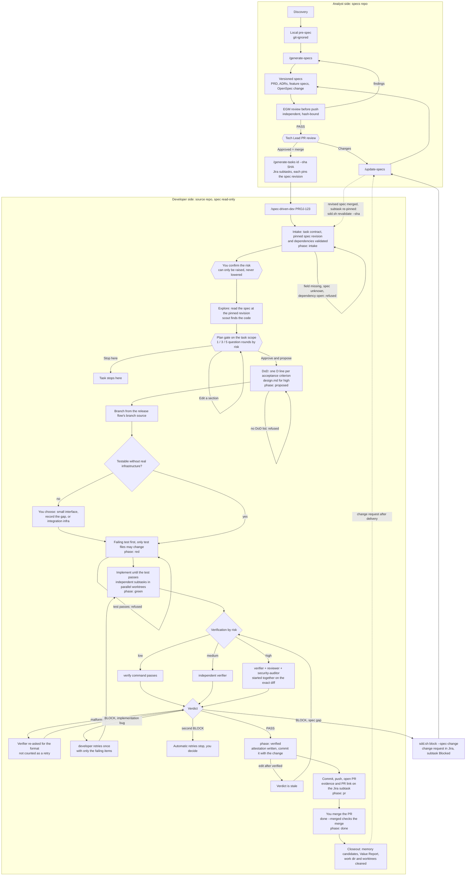

<div align="center">

# SDKit

### Spec-driven development for AI coding agents

**Make your coding agent follow a real engineering process, enforced by scripts instead of left to its good intentions.**


[Quick Start](#-quick-start) · [How It Works](#-how-it-works) · [Supported Agents](#-supported-agents) · [Docs](#-documentation)

</div>

---

> `spec-driven-kit` · command `sdkit`

You ask an agent to build a feature. It skips the plan, writes the code, decides on its own that the work is done, and drifts from what was agreed. Prompts that ask it to behave are only suggestions.

**SDKit turns "ask the agent to build it" into a gated workflow, from the first idea to the merged PR:**

**pre-spec → reviewed, versioned spec → Tech Lead approval → Jira subtasks → plan → proposal with a Definition of Done → failing test → implementation → independent verification → PR.**

A phase machine blocks the shortcuts (code before a plan, push before verification), and a separate verifier agent, not the one that wrote the code, decides whether the work is done.

It runs on **Claude Code, Codex, OpenCode, Cursor and Gemini CLI**, on **Go, Spring Boot / JVM, Python, Next.js, React Native** or any other stack, and it carries **no project facts**: each repo brings its own risk rubric, rules and checks.

---

## ✨ Features

### 🔒 The author never signs off
For medium and high risk, a verifier that never saw the implementation reasoning checks the diff against the Definition of Done. Edit anything after verification and the verdict is stale.

### 🧭 Order is enforced
Hooks, git hooks and CI all ask the same rule: no code before a proposal and a failing test, no push or PR before verification.

### 🎚️ Risk sets the rigor
Low is one session. Medium adds a mandatory verifier. High splits test writer, implementer and verifier into separate agents and freezes the regression test.

### 🧑‍💼 You stay in control
You confirm the risk label (it can only be raised) and approve the plan before anything is proposed. Incidents become lasting guards (`incident-to-rule`).

### 📝 Spec first, with an independent review
Analysts turn a pre-spec into a reviewed, versioned spec. The Tech Lead approves by merging. Every Jira subtask pins one spec revision, and a spec defect becomes a change request instead of a workaround.

### 💸 Cost is measured, not promised
A usage ledger, budgets and a Value Report show tokens and cost per task, and print `N/A` where records are missing.

### 🤝 One process for the whole team
One committed `.sdkit/` (risk rubric, rules, checks) gives everyone, on any supported agent, the same process with the same CI gate.

### What you get

| Area | Plain agentic development | With SDKit | Evidence |
|---|---|---|---|
| **Token use** | One strong model reads, searches and re-reads in a growing context | Tiered models, short handoffs, cached verification and scouting, budgets | **~70% lower total token use**, measured by the maintainer on their own workloads |
| **Cost** | Top-tier model for every step | Cheap tier for search and planning checks, strong tier only for design and high-risk verification | Estimated against a stated baseline in the Value Report |
| **Time** | Sequential work in one session; rework after review finds missed requirements; repeated test runs | Independent tasks run as parallel subagents in separate worktrees; gaps caught at intake; no repeated work on an unchanged tree | **~40% less wall-clock time**, measured by the maintainer on their own workloads |
| **Efficiency and quality** | The author reports "done" | Verifier checks the diff against the Definition of Done; stale verdicts are refused after any edit | Enforced by the phase gate; `sdkit report task` shows the verdict |
| **Team work** | Every developer prompts differently | One committed `.sdkit/`, the same process on any agent, the same CI gate | Enforced by hooks, git hooks and CI |
| **Visibility** | A chat log | Phase, evidence, tokens and cost on demand; per-task Value Report | Local records, no model call |

> **Note:** the ~70% (tokens) and ~40% (time) figures are a single maintainer's measurements, not benchmarks: results depend on task mix, model and stack. Measure your own with `sdkit report task <task>`, which prints `N/A` rather than a guess. Method and caveats: [docs/design-report.md](docs/design-report.md).

---

## 🚀 Quick Start

### 1. Install the kit, once per machine

```sh
brew tap wecii/sdkit https://github.com/wecii/sdkit.git
brew trust wecii/sdkit      # recent Homebrew asks for this once
brew install sdkit          # brings jq and node
```

> No Homebrew? Clone this repo and use `<kit>/bin/sdkit` the same way. Maintainers: [packaging/homebrew/README.md](packaging/homebrew/README.md).

### 2. Set a repo up, once, by one person

```sh
cd your-repo
sdkit init                  # Claude Code by default; --host codex | opencode | cursor | gemini | claude,codex,...
```

`init` detects the stack and base branch, writes the project profile, installs the host files and sets up OpenSpec, the spec engine the workflow drives (`--install-openspec` installs its CLI if missing). Then:

1. Fill in `.sdkit/project.md`. **The risk rubric is mandatory**; the workflow will not start without it.
2. Enable the `verify.d/` policies you want (rename `*.example` to `*.sh`). Team settings live in `.sdkit/sdkit.env` (committed); your personal ones in `.sdkit/sdkit.local.env` (not in git). Every setting is already there with its default.
3. Run `sdkit doctor` and fix every `FAIL`.
4. Commit `.sdkit/`, `AGENTS.md` and the kit block in `.claude/CLAUDE.md`. Add `--ci github`, `--ci gitlab` or `--ci bitbucket` to install the server-side gate too.

### 3. Join, every other developer

Install sdkit on your machine; host files are generated per machine and hidden from git.

- **Claude Code:** run `claude` and accept the plugin prompt once.
- **Codex, OpenCode, Cursor, Gemini:** `git config core.hooksPath .githooks` once per clone.

### 4. Start a task

| Host | Command |
|---|---|
| Claude Code | `/spec-driven-dev <ticket or description>` |
| Codex | `$spec-driven-dev <ticket or description>` |
| OpenCode, Cursor, Gemini | ask the agent to use the `spec-driven-dev` skill on the task |

> **Updating:** `brew upgrade sdkit`, then `sdkit upgrade` in each repo (and refresh the plugin in Claude Code with `/plugin`). It adds what is new and never touches your files. Manual steps per version: [docs/upgrading.md](docs/upgrading.md).

### Pick an environment

`sdkit init --env analyst|developer` picks an experience; without it nothing changes (`SDKIT_ENV=standalone`, a single repo with a free-text task).

```sh
sdkit init --env analyst    # specs repo.   then: /generate-specs onboarding
sdkit init --env developer  # source repo.  then: /spec-driven-dev PROJ-123
```

- **analyst** (a specs repo): `/generate-specs` turns a pre-spec into a reviewed spec, outputs it as an OpenSpec change and opens one PR. The Tech Lead approves by merging. `/update-specs` changes an approved one, `/generate-tasks` writes Jira subtasks from it.
- **developer** (a source repo): `/spec-driven-dev PROJ-123` runs the same phases and gates, but the task and its pinned spec revision come from Jira. A spec defect never gets worked around: it becomes a change request and the task stays blocked until the revised spec is pinned.

Flows, limits and open decisions: [docs/role-aware.md](docs/role-aware.md).

---

## 🔄 How It Works

SDKit covers the path from a raw idea to a verified PR in two halves that meet at a Jira subtask: the **analyst side** produces an approved, versioned spec, and the **developer side** implements one subtask of it.



### The lifecycle

| Lifecycle phase | Who / what | Output |
|---|---|---|
| **Discovery**, **Pre-spec** | The analyst, outside the kit. `sdkit prespec check <name>` verifies the pre-spec exists and stays git-ignored | A local pre-spec that is never committed |
| **Specification** | `/generate-specs`: questions, PRD, ADRs, feature specs with stable AC ids, independent [EGM](https://github.com/google/elephant-goldfish-model) review, `openspec-propose`; one PR on `spec/<id>` only after a review PASS. `/update-specs` handles edits and change requests | A reviewed, versioned spec. The Tech Lead approves by merging |
| **Task planning** | `/generate-tasks <id> --sha <SHA>`: traces every AC to a task, rejects dependency cycles, upserts Jira subtasks idempotently | Jira subtasks that pin the approved spec revision |
| **Execution** | `/spec-driven-dev PROJ-123`: the phase machine below, one subtask per run; independent subtasks can run in parallel sessions | A verified diff with evidence |
| **Delivery** | Commit, push and PR are denied until verified; you merge. Release steps come from `project.md` and are relayed, never run | A merged PR |
| **Evolution** | Closeout and Value Report; a spec defect found while building becomes a change request that goes back to `update-specs` | Archived artifacts, report, change requests |

### Principles

1. **A pre-spec is a draft.** It is the spec's input, stays local and git-ignored, and is never committed or sent to the customer.
2. **The spec is the decision.** Alignment and development go through the spec only.
3. **Approval is the merge of the spec PR.** A review PASS is not approval. The version label (1.0, approved) is set by the last commit of the approval PR.
4. **The developer does not write or change the spec.** A defect blocks the subtask and becomes a change request; work resumes only after the revised spec is merged and the subtask pins it.
5. **Every subtask pins one spec revision** (`specSha`, a git commit). A subtask missing a contract field is refused at start.
6. **Task creation is idempotent.** Running `generate-tasks` twice on the same spec updates the subtasks, it never duplicates them.
7. **`spec-driven-dev` starts from the subtask.** In developer mode it never regenerates the PRD, architecture or spec.

The kit does not run discovery, release or deploy for you.

### 🐘 EGM reviews the spec before anything is pushed

[EGM](https://github.com/google/elephant-goldfish-model) (Elephant Goldfish Model) is a Claude Code plugin (`egm@egm`) whose `egm-review-loop` skill runs fresh-context reviewers against a document and a standard. `generate-specs` and `update-specs` run it per artifact (PRD, ADR, feature spec) and once more on the final OpenSpec change, with the rubric in `.sdkit/review.d/<artifact>.env`.

`scripts/review.sh` keeps the evidence honest: the PASS is bound to the document's content hash, any edit makes it stale, a review without fresh isolation is `NOT_RUN` and never PASS, and `spec.sh publish` refuses without a fresh PASS. After `SPEC_REVIEW_MAX_ROUNDS` rounds a person decides. Without the plugin, the read-only `spec-reviewer` role runs the same review through `run-role.sh`. A review PASS is not approval; the Tech Lead's merge is.

---

## 🛠️ Inside `spec-driven-dev`

The developer side is a **phase machine** (`scripts/sdd.sh`). Each move has an exit condition that a script checks, so the agent cannot skip a step by deciding it is not needed. In this mode the skill writes no spec: it never calls the OpenSpec skills, and nothing under `SPECS_DIR` can be edited. At the start and end of every step it prints `[sdkit] orchestrator · Step <n>/<total>: <name> — started|done`; the total is 7 for `low` and 8 for `medium` and `high`.

Gate phases: `intake → proposed → red → green → verified → pr → done` (plus `aborted`). Planning happens inside `intake`.

> **Standalone mode** (`SDKIT_ENV=standalone`, no Jira): `/spec-driven-dev <description>` runs the same phases on a free-text task. The differences are at the edges: the `analyst` role checks the request and proposes the risk, `openspec-explore` grounds the problem, `openspec-propose` writes `proposal.md` / `design.md` / `specs/` / `tasks.md` from the approved plan, and closeout syncs and archives the specs with `openspec-sync-specs` and `openspec-archive-change`.

### Step by step

| Step | Phase | What happens | It moves on when |
|---|---|---|---|
| **Intake** | `intake` | `sdd.sh start --ticket <KEY>` fetches the subtask, validates its contract, checks that the pinned `specSha` exists in `SPECS_DIR` and that every dependency is done. The risk comes from the task | The start is accepted and you confirm the risk (you can only raise it) |
| **Explore** | `intake` | Read the spec at the pinned revision; `scout` answers "where is X" cheaply, cached per code state | The problem is grounded in code and spec |
| **Plan gate** | `intake` | For medium/high the `engineer` drafts design, test strategy and task split. You are questioned on the plan in batched rounds (1 low, 3 medium, 5 high). Work outside the task's `scope` is a question, not a silent extension | You pick `Approve and propose` |
| **Definition of Done** | `proposed` | `start` already wrote one `D<n>: ... \| Verified by: ...` line per acceptance criterion; you refine each from the spec text and write `design.md` for high | `advance proposed` re-fetches the contract (same `specSha`), re-checks dependencies and finds the DoD list (high: also a race/ordering section) |
| **Test first** | `red` | `test-writer` writes the failing test. Only test files may change | `advance red` runs the test and it **fails** |
| **Implement** | `green` | `developer` writes code until the test passes. Independent tasks (disjoint `writes:`) run as parallel subagents in separate worktrees | `advance green` runs the test and it **passes** |
| **Verify** | `verified` | Depends on risk (see below). Evidence is tied to the exact diff, and the attestation records the ticket and `specSha` | A PASS for this diff |
| **PR** | `pr` | Commit, push and open the PR. Push is denied before `verified`. `sdd.sh evidence-sync` comments the evidence and PR link on the subtask and moves it to `JIRA_REVIEW_STATUS` | `advance pr` |
| **Closeout** | `done` | After you merge: `done --merged` checks that the PR head is in the base branch. Memory entries you pick, Value Report written | `advance done` |

### Risk decides the rigor

| Risk | What happens |
|---|---|
| `low` | DoD → RED → implement → GREEN → PR. No separate verifier |
| `medium` | Same, plus a **mandatory independent verifier** before the PR |
| `high` | Race/ordering scenario in `design.md`; one agent writes and freezes a regression test against real infrastructure, another implements, a third verifies; plus code and security review |

A verifier `BLOCK` gets one automatic retry; a second stops and hands the decision to you.

### When it is not a straight line

| Situation | What SDKit does |
|---|---|
| Task contract incomplete, spec revision unknown or dependency open | `sdd.sh start` is refused and says why |
| You want to change the plan | `Edit a section` re-runs only the affected rounds; `Stop here` ends the task |
| Proposal has no Definition of Done | `advance proposed` is refused with the reason; fix and retry |
| Test passes before any code exists | `advance red` is refused: the test must fail, for the right reason |
| Tasks overlap or depend on each other | `after:` links order them; tasks with overlapping `writes:` never run in parallel (`plan-waves.sh` computes the waves) |
| Verifier `BLOCK`, implementation bug | One automatic retry with only the failing items |
| Verifier `BLOCK` or any finding that the spec itself is wrong | `sdd.sh block --spec-change` files a change request in Jira and blocks the task. Every `advance` and every code edit is refused until the revised spec is merged and `sdd.sh revalidate --sha <new sha>` passes. No retry against a broken target |
| Second `BLOCK` | Automatic retries stop and you decide. No third loop |
| Code edited after verification | The verdict is stale; push and PR are refused until you verify again |
| Valid evidence already exists for this diff | With `ROUTING=on` it is reused and nothing runs again |
| Budget would be exceeded | Stops before the spawn that goes over; you continue, raise the limit or stop. Verification is never shortened |
| Session crashed or was killed | Records stay on disk; `recover.sh scan` and `state.sh <task> show` resume the task |
| You abandon the task | `sdd.sh abort` ends it and still writes the report |

Every box maps to a real mechanism. Real command output for each step: **[docs/developer-workflow.md](docs/developer-workflow.md)** §5 and §10.

### 📍 Where am I?

There is no dashboard; these read-only commands answer it (`KIT="$(sdkit where)"`, run inside your repo):

| Question | Command |
|---|---|
| Phase and active task | `$KIT/scripts/sdd.sh status` → `task=rate-limit risk=medium phase=green` |
| Which verifier / reviewer / auditor PASS is missing | `$KIT/scripts/sdd.sh evidence` |
| What the task requires, what each move needs | `$KIT/scripts/sdd.sh policy`, `sdd.sh transitions` |
| Why was I stopped | the refusal message names the missing step; `sdd.sh gate edit <path>` re-asks |
| Tokens, cache, cost, budget | `$KIT/scripts/usage.sh report <task>`, `usage.sh budget` |
| Result of a task | `sdkit report task <task>` |

More in [docs/developer-workflow.md](docs/developer-workflow.md) §7 and the one-page [docs/cheatsheet.md](docs/cheatsheet.md).

---

## 🎭 Roles and Skills

Your session is the *orchestrator*. It hands narrow jobs to *roles*, each run as a fresh agent. Roles declare a cost tier, never a model name. The `orchestrator` is not an agent file: it is your own session, playing the role defined in `core/roles/orchestrator.md`.

Eight skills and eleven roles ship in this version.

### Roles

| Role | Job |
|---|---|
| `analyst` | Standalone intake: is the request complete, what risk |
| `scout` | Cheap read-only lookups ("where is X", call sites), so costly roles do not search |
| `engineer` | Design and test strategy for medium/high (designs, never implements) |
| `test-writer`, `developer`, `devsecops` | Tests, code, pipelines |
| `verifier` | Medium/high: checks the diff against the DoD. Read-only |
| `reviewer`, `security-auditor` | Required at high (security-auditor also for pipeline/infra). Read-only |
| `spec-reviewer` | Analyst environment: reviews a PRD, ADR or feature spec against a rubric. Read-only |

### Skills

| Skill | Use it to |
|---|---|
| `spec-driven-dev` | Run a task through the whole workflow above (the driver; it calls the OpenSpec skills) |
| `generate-specs` | Analyst: turn a pre-spec into reviewed specs, an OpenSpec change and one PR |
| `update-specs` | Analyst: change a published spec after edits or Tech Lead change requests (after approval: write a change under `specs/<id>/changes/`) |
| `merge-specs` | Analyst: merge sibling spec changes into the next revision (semantic merge, a person decides conflicts) |
| `generate-tasks` | Analyst: split an approved spec into Jira subtasks |
| `incident-to-rule` | Turn a resolved bug or incident into a lasting guard |
| `scaffold-init`, `scaffold-doctor` | Set a repo up, and check that the setup is complete |

---

## 💰 Token and Cost Control

Agent workflows spend most of their tokens on searching, re-reading and long contexts. SDKit keeps that in check and measures it, so you decide from numbers instead of guesses. The limits are empty by default; the kit imposes none of its own.

| Lever | How it works |
|---|---|
| **Model tiers** | Roles declare a cost tier: `light` (search, planning check), `standard` (most work), `strong` (design, high-risk verification). `core/tiers.env` maps tiers to models, e.g. `haiku` / `sonnet` / `opus` on Claude Code. Independent roles never drop below their own tier |
| **Right-sized work** | Each task in the plan gets a `size`, which picks the tier. You can change it at the plan gate. Low risk skips the engineer, the independent verifier and parallel waves |
| **Subagents keep context small** | A role gets a short handoff with file paths, not the conversation. It returns at most 15 lines and files the long form under `work/<slug>/out/`. Roles never spawn roles, and one- or two-file work stays in the main session |
| **Context growth** | `SKILL.md` is short and step detail loads only when needed. Command output is trimmed to a summary plus failing lines (`capped.sh`). Progress is checkpointed so `/clear` or compaction loses nothing |
| **Cheap before expensive** | `verify.sh` runs before the LLM review; plan parity, verdict parsing, write-set and retry checks are scripts, not model calls. Green verification is cached per code state and scout answers per question |
| **Cache hit ratio** | Handoffs put fixed lines first and changing lines last, tasks in a wave share a model and spawn together, so the prompt cache keeps hitting. `usage.sh report` prints the hit rate |
| **Budgets** | `MAX_SPAWNS` and `TOKEN_BUDGET_TASK` stop and ask before the spawn that goes over (`strict`) or only warn (`guided`). A budget stop never shrinks verification |
| **Routing** (`ROUTING=on`) | A deterministic function, with no model call, decides which adapter and model run a role and whether to run, reuse valid evidence, retry or escalate. Risk floors and mandatory gates are never lowered |
| **Local measurement** | `USAGE_LOG=1` writes a per-run ledger (role, tier, model, input, output, cache tokens). `TELEMETRY=1` records phases, agent runs, retries and failures as local events. Nothing leaves your machine and no prompts are logged |
| **Honest numbers** | Every figure is labelled actual, estimated or unavailable. Where a host reports no token usage the ledger stays empty and budgets stay silent; the kit does not guess |

Read the result with `usage.sh report <task>` for tokens, cache hit rate and budget, or `sdkit report task <task>` for the Value Report: per-role tokens, API-equivalent cost and savings against a stated baseline. Orchestration adds agent runs, so SDKit does not assume it saves money; it reports only what the records support. Details: [guide §18](docs/guide.md), [design-usage.md](docs/design-usage.md), [design-routing.md](docs/design-routing.md), [design-telemetry.md](docs/design-telemetry.md).

---

## 🧱 How It Is Enforced

| Layer | Where | What it stops |
|---|---|---|
| Phase gate | `scripts/sdd.sh gate`, the single decision point | code before a proposal and a failing test; push/PR before verification; any edit after verification |
| Agent hooks | Claude Code (full set), Gemini/Cursor/OpenCode (adapters) | the above per tool call, plus secrets, protected paths, frozen tests, prod `kubectl`, release-flow git mistakes |
| Git hooks | `.githooks/`, every tool | the same gate at commit and push time |
| CI | `sdkit init --ci ...` | a PR whose code change has no committed attestation for exactly that diff; medium/high also need a verifier PASS. The job runs the **base branch's** `sdd.sh`, so a PR cannot edit the check that judges it |

`SDD_MODE` in `sdkit.env`: `strict` (default) denies, `guided` asks or warns, `off` disables. Git hooks can be skipped with `--no-verify`; CI cannot, so mark the CI check as required. Details: [docs/guide.md](docs/guide.md).

---

## 🤖 Supported Agents

Roles are written once in `core/roles/` and generated for each host. Every agent gets the workflow skill, the role files and the git-hook gate; the strength of the in-session guard differs.

| Agent | Install | Start a task | In-session guards | Status |
|---|---|---|---|---|
| **Claude Code** | `sdkit init` (default) | `/spec-driven-dev` | hooks the model cannot skip, as a plugin | Validated on live installs |
| **Codex** | `--host codex` | `$spec-driven-dev` | sandbox `read-only` for read-only roles + git hooks | Follows documented format |
| **OpenCode** | `--host opencode` | ask for the `spec-driven-dev` skill | JS plugin + git hooks | Follows documented format |
| **Cursor** | `--host cursor` | ask for the `spec-driven-dev` skill | `hooks.json` + git hooks | Follows documented format |
| **Gemini CLI** | `--host gemini` | ask for the `spec-driven-dev` skill | `settings.json` hooks + git hooks | Follows documented format |

Mix hosts with `--host claude,codex`. Any agent that reads `AGENTS.md` and runs shell commands still gets the phase gate through git hooks and CI, and `run-role.sh` can run the verifier in a different provider for real independence. Per-host details and limits: [docs/guide.md](docs/guide.md) §16.

## 🧰 Supported Stacks

`init` detects the stack and wires in its verify commands (format, lint, test, build), permissions, rules and known pitfalls. One stack per repo.

| Stack | Detected by | Id |
|---|---|---|
| **Go** | `go.mod` | `go` |
| **Spring Boot** | Maven/Gradle build that uses Spring Boot | `spring-boot` |
| **JVM** | any other `pom.xml`, `build.gradle(.kts)` | `jvm` |
| **Python** | `pyproject.toml`, `setup.py`, `requirements.txt` | `python` |
| **Next.js** | `next` in `package.json` | `nextjs` |
| **React Native** | `react-native` in `package.json` | `react-native` |
| **Anything else** | fallback: you supply the verify commands | `generic` |

Adding a stack: [stacks/README.md](stacks/README.md).

---

## 👥 Who Edits What

You never edit the kit. You edit your own repo, and the kit writes only its own part of any shared file.

| In your repo | Owner |
|---|---|
| `.sdkit/project.md`, `rules/`, `verify.d/`, `memory/`, `roles.d/`, your own skills and agents | **You**, shared by the team via git; the kit never touches them after creation |
| `.sdkit/sdkit.env` | **Team**: committed policy; the kit only appends new settings |
| `.sdkit/sdkit.local.env` | **Each developer**: personal, not in git, wins over `sdkit.env` |
| `AGENTS.md`, `CLAUDE.md`, `.codex/config.toml`, `.cursor/hooks.json`, `.gemini/settings.json` | **Shared**: the kit owns only its marked `spec-driven-kit:begin … end` block or its own keys |
| kit scripts, hooks, role files, `.githooks/`, `settings.local.json` | **Kit**: generated per machine, hidden from git, refreshed by `sdkit sync` |

To adapt a role, write `.sdkit/roles.d/<role>.md`. `sdkit sync --check` and `sdkit doctor` report drift. Full ownership table: [docs/guide.md](docs/guide.md) §3.

## 🔌 Optional Features

Configured in `.sdkit/sdkit.local.env`. Cost, budget, routing and telemetry features are covered in [Token and Cost Control](#-token-and-cost-control).

| Feature | What it gives you | Details |
|---|---|---|
| **Memory** (`MEMORY=1`, on) | Durable facts and decisions in `.sdkit/memory/`, one index line each, shared through git | [guide §19](docs/guide.md) |
| **Workflow profiles** | `sdd.sh start --profile small\|standard\|high-assurance`: process weight, separate from risk. A profile never removes a gate | [design-workflow.md](docs/design-workflow.md), [design-evidence.md](docs/design-evidence.md) |
| **Agent contracts** (`CONTRACTS=1`) | Checked handoff and result lines between orchestrator and roles | [design-contracts.md](docs/design-contracts.md) |
| **Benchmarks** | `bench/run.sh` simulates four workflows for free; a task-level benchmark compares plain agentic development with SDKit | [design-benchmark.md](docs/design-benchmark.md) |

## ⌨️ The `sdkit` Command

| Command | Does |
|---|---|
| `sdkit init [options] [dir]` | Set a repo up (profile, host files, OpenSpec, optional CI) |
| `sdkit doctor [dir]` | Check a repo and say what to fix |
| `sdkit sync [--check] [dir]` | Refresh the kit's files; `--check` only reports drift |
| `sdkit upgrade [dir]` | Bring a repo to the installed kit version |
| `sdkit install` | Register a cloned kit on the machine for the git hooks (not needed with Homebrew) |
| `sdkit report task\|session\|latest\|history` | The Value Report |
| `sdkit version`, `sdkit where` | Version, and where the kit lives |

---

## 📋 Requirements

- `git`, `jq`, `node` (for OpenSpec) and your stack's toolchain. The analyst environment also uses the [EGM](https://github.com/google/elephant-goldfish-model) plugin for spec review (or the `spec-reviewer` role as fallback). `sdkit doctor` lists what is missing.
- macOS and Linux. Windows is not supported (the kit is bash).
- Pull requests: Bitbucket (REST API), GitHub (`gh`) and GitLab (`glab`). `PR_HOST=auto` picks one from the origin URL ([docs/hosts.md](docs/hosts.md)).
- `<project-dir>` is `.sdkit/` for every host. Repos set up before 1.0 keep their old directory until `sdkit upgrade --migrate`.

## ⚠️ Limits

- Guards are regex-based safety nets, not a security boundary. They keep a cooperative agent on the workflow; an agent that tries to get around them can (Bash writes are not phase-gated).
- An attestation is a JSON file the author commits: `ci-check` proves the flow was run for exactly this diff, not who ran it or that the verifier was independent. Protect `.sdkit/`, `attestations/` and the CI file with CODEOWNERS.
- One stack per repo.
- `spec-driven-dev` drives the OpenSpec skills, so the `openspec` CLI is required.

---

## 📚 Documentation

| Read | When |
|---|---|
| [docs/README.md](docs/README.md) | Not sure where to start |
| [docs/developer-workflow.md](docs/developer-workflow.md) | The whole developer journey, from init to Value Report |
| [docs/role-aware.md](docs/role-aware.md) | Analyst and developer environments, Jira tasks |
| [docs/cheatsheet.md](docs/cheatsheet.md) | One-page daily reference |
| [docs/guide.md](docs/guide.md) | Every skill, role, hook, setting, install flow and limit |
| [docs/upgrading.md](docs/upgrading.md) | Updating projects between kit versions |
| [docs/hosts.md](docs/hosts.md) | Pull-request host setup |
| [stacks/README.md](stacks/README.md) | What a stack provides |
| [core/roles/README.md](core/roles/README.md) | Role format and roster |

## 🤝 Contributing

1. Read [CONTRIBUTING.md](CONTRIBUTING.md) and the rules in [CLAUDE.md](CLAUDE.md).
2. Roles are edited in `core/roles/`; run `bin/build-adapters.sh` and commit its output.
3. Run `scripts/test-select.sh run` and `bin/build-adapters.sh --check` before opening a PR.
4. Commits follow `core/rules/git.md`: `<type>(<scope>): <description>`.

## 📄 License

[MIT](LICENSE)
