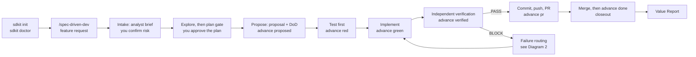
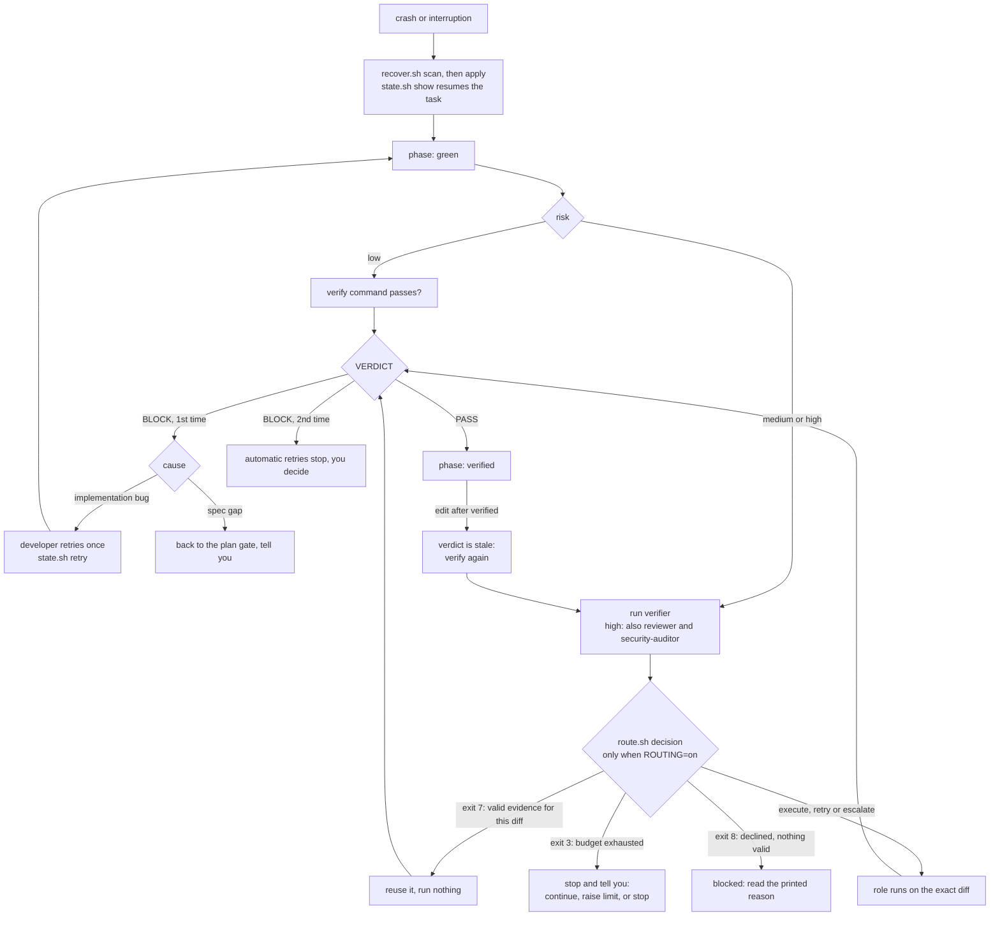

# SDKit developer workflow: from `sdkit init` to the Value Report

This guide follows one developer through one feature, end to end, and says for every step **what happens, why, and what you see**.
It describes the kit as it is in this repository. Where something is not automated, not observable or not shipped, it says so
(look for **Limit** and **Proposed**). Short entry point: [README.md](../README.md). Reference for every setting, hook and role:
[guide.md](guide.md) (Turkish).

Conventions used below:

- `KIT="$(sdkit where)"` is the kit's root. The workflow scripts live in `$KIT/scripts/`. (Claude Code plugin mode: the same files are
  `${CLAUDE_PLUGIN_ROOT}/scripts/`. Other hosts also get copies in `.sdkit/scripts/`.) Run them from inside your repo.
- `<project-dir>` is `.sdkit/`. `<slug>` is the task id (for example `rate-limit`).
- Output blocks marked *captured* were produced by running the real scripts in a scratch repository without any model call.
  Values inside them that came from fixtures are fictional.

## Contents

1. [What is SDKit](#1-what-is-sdkit) · 2. [Why use it](#2-why-developers-use-it) · 3. [Install and initialise](#3-installation-and-initialisation)
4. [Start `/spec-driven-dev`](#4-starting-spec-driven-development) · 5. [The lifecycle](#5-the-development-lifecycle) · 6. [Agents and roles](#6-how-sdkit-orchestrates-agents-and-roles)
7. [Where am I?](#7-how-progress-and-the-current-phase-are-tracked) · 8. [Quality gates](#8-verification-and-quality-gates) · 9. [Routing and cost](#9-routing-and-cost-controls)
10. [Failure](#10-what-happens-when-something-fails) · 11. [Completion](#11-how-tasks-and-sessions-complete) · 12. [Value Report](#12-the-sdkit-value-report)
13. [Commands](#13-frequently-used-commands) · 14. [Worked example](#14-worked-example-rate-limiting-an-api) · 15. [Troubleshooting and limits](#15-troubleshooting-and-limitations)

---

## 1. What is SDKit

SDKit (`spec-driven-kit`, command `sdkit`) is a development process for AI coding agents that is **enforced by scripts, not by prompts**.
It has three parts:

| Part | What it is | Where |
|---|---|---|
| The workflow skill | `spec-driven-dev`: the orchestrator's instructions (intake, plan, propose, test-first, verify, PR, closeout) | `skills/spec-driven-dev/` |
| The phase machine and guards | `sdd.sh` decides what may change when; hooks and git hooks ask it on every edit, push and PR | `scripts/sdd.sh`, `hooks/`, `adapters/git/` |
| Roles and tooling | Ten neutral role definitions turned into agent files for five hosts; routing, usage ledger, telemetry, reports | `core/roles/`, `scripts/` |

It works with Claude Code, Codex, OpenCode, Cursor and Gemini CLI. The Claude Code integration is the one exercised on live installs;
the others follow each tool's documented format ([hosts and limits](#15-troubleshooting-and-limitations)).

## 2. Why developers use it

- **The agent that wrote the code cannot declare it done.** For medium and high risk a separate verifier checks the diff against a
  written Definition of Done (DoD).
- **The order is a mechanism.** Code edits are refused until a proposal with a DoD exists and a test has failed (RED). Push and PR are
  refused until verification passed for exactly this diff.
- **You approve the plan and the risk label** before anything is proposed.
- **Cost and token use are measured** (ledger, budgets, report), not guessed. SDKit does not promise a saving; the Value Report shows one
  only where records support it ([section 12](#12-the-sdkit-value-report)).

## 3. Installation and initialisation

### Install the kit (once per machine)

```
brew tap wecii/sdkit https://github.com/wecii/sdkit.git
brew trust wecii/sdkit
brew install sdkit                 # brings jq and node
sdkit version                      # e.g. "sdkit 1.3.0"
```

No Homebrew: clone the repo and run `<kit>/bin/sdkit`; `sdkit install` registers a cloned kit for the git hooks.
Requirements: `git`, `jq`, `node` (OpenSpec) and your stack's toolchain.

### Set up a repo (once, by one person)

```
cd your-repo
sdkit init                          # Claude Code (default)
sdkit init --host codex             # or opencode | cursor | gemini | claude,codex,...
sdkit init --ci github              # optional: also install the server-side gate (bitbucket | github)
```

*Captured* (abridged), `sdkit init` in a Go repo:

```
spec-driven-kit 1.3.0 -> /tmp/sc (host=claude dir=.sdkit mode=plugin stack=go base=main)
rules and stack defaults (project-owned: edit freely)
  wrote  .sdkit/rules/general.md (project-owned: edit it)
  ...
project profile (project-owned: fill in)
  wrote  .sdkit/sdkit.env (project-owned: edit it)
  wrote  .sdkit/project.md (project-owned: edit it)
  wrote  .sdkit/known-pitfalls.md (project-owned: edit it)
ci gate scripts (managed: sync.sh updates them)
  wrote  .sdkit/scripts/env.sh
  wrote  .sdkit/scripts/sdd.sh
settings
  wrote  .claude/settings.local.json
  wrote  .claude/CLAUDE.md (new; your own text goes outside the kit block)
openspec (required by the workflow)
  11 skills and 11 commands in .claude/
  wrote  openspec/ and OpenSpec skills for: claude
done. next: fill in .sdkit/project.md and review .sdkit/sdkit.env, rename the verify.d/*.example files you want, then run:
  .../bin/doctor.sh /tmp/sc
```

What it installs:

| Where | What | Owner afterwards |
|---|---|---|
| `.sdkit/sdkit.env` | the team's settings (stack, base branch, `SDD_MODE`, protected paths, `ROUTING`, `REPORT_BASELINE_MODEL` ...), committed | team |
| `.sdkit/sdkit.local.env` | your personal settings (usage log, telemetry, budgets, hosts, `VALUE_REPORT`), git-ignored, read after `sdkit.env` | you |
| `.sdkit/project.md`, `known-pitfalls.md`, `rules/`, `verify.d/*.example`, `adr/`, `memory/` | project facts: **risk rubric (mandatory)**, tracker and PR tooling, release flow, test layout, rules | you |
| `.sdkit/scripts/sdd.sh`, `env.sh`, `resolve-base.sh` | the only kit scripts the server-side CI gate needs | kit |
| `.claude/settings.local.json`, `.claude/CLAUDE.md` (kit block) | host wiring: plugin enabled, `permissions.deny`; the kit owns only its marked block | shared |
| `openspec/` and the `openspec-*` skills / `opsx` commands | the spec engine `spec-driven-dev` drives (`--install-openspec` installs its CLI if missing) | OpenSpec |
| `AGENTS.md`, `.githooks/` (hosts other than Claude Code), `.codex/`, `.opencode/`, `.cursor/`, `.gemini/` | per-host files, hidden from git in this clone via `.git/info/exclude` | kit |

Skills available after init: `spec-driven-dev` (the workflow), `scaffold-init`, `scaffold-doctor`, `incident-to-rule`, plus the OpenSpec
skills. Agents (roles) and adapters: [section 6](#6-how-sdkit-orchestrates-agents-and-roles). `init` never overwrites `project.md`, `sdkit.env`
(it only appends new settings), `rules/` or an existing `settings.json`, not even with `--force`. Hooks that need a setting stay silent
while the setting is empty; **the phase gate is on by default** (`SDD_MODE=strict`).

### Verify the installation

```
sdkit doctor
```

*Captured* (abridged): `ok` lines for settings, risk rubric, hooks wiring, CLI tools, OpenSpec; then

```
  FAIL  project.md still has TODO placeholders
  warn  no active verify.d policy (rename .example files to enable the ones you want)
  warn  no server-side gate in CI: local hooks can be skipped with --no-verify (init.sh --ci bitbucket|github)
doctor: 1 failure(s), 2 warning(s)
```

Fix every `FAIL` (typically: fill in `project.md`), commit `.sdkit/`, `AGENTS.md` and the kit block in `.claude/CLAUDE.md`.
Every other developer installs `sdkit` on their machine and, for Claude Code, accepts the plugin prompt once; for the other hosts they run
`git config core.hooksPath .githooks` once per clone.

### Setting defaults that matter for this guide

| Setting (file) | Default after `init` | Effect |
|---|---|---|
| `SDD_MODE` (`sdkit.env`) | `strict` | phase gate denies out-of-phase edits, push, PR; `guided` asks/warns; `off` disables |
| `ROUTING` (`sdkit.env`) | `off` | route.sh decisions are not applied by `run-role.sh` ([section 9](#9-routing-and-cost-controls)) |
| `CONTRACTS` (`sdkit.env`) | empty (off) | handoff contracts are optional and unchecked |
| `USAGE_LOG` (`sdkit.local.env`) | `1` | token ledger on |
| `TELEMETRY` (`sdkit.local.env`) | empty (off) | no event log, so the Value Report shows tests and gates as N/A |
| `TOKEN_BUDGET_TASK`, `MAX_SPAWNS`, `ROUTE_*` budgets | empty (off) | no limits; the kit imposes no numbers |
| `VALUE_REPORT` (`sdkit.local.env`) | `on` in the current template | automatic report at task end and session end (a repo created earlier gets it from `sdkit upgrade`) |
| `REPORT_BASELINE_MODEL` (`sdkit.env`) | empty | routing savings stay N/A until you name a baseline model |

## 4. Starting spec-driven development

Open the repo in your host and give the workflow a ticket id or a free-text description:

| Host | Command |
|---|---|
| Claude Code | `/spec-driven-dev <ticket or description>` |
| Codex | `$spec-driven-dev <ticket or description>` |
| OpenCode, Cursor, Gemini | ask the agent to use the `spec-driven-dev` skill |

**What the skill expects from you:** a task (ticket id when `TRACKER` is set, else text), answers to the analyst's questions, confirmation of
the risk label, approval of the plan, and the post-merge steps. `project.md` must contain a risk rubric; without one the skill stops and
asks you to write it (it never invents criteria).

**What the orchestrator does first** (SKILL.md "Resume" and step 0):

1. Reads `sdkit.env`, `project.md`, `known-pitfalls.md`, memory index (if `MEMORY=1`) and `rules/*.md`.
2. If `state.sh <slug> show` already has a state for this task, continues from its `step` instead of starting over.
3. Fetches the ticket (when applicable) and runs the **`analyst`** role: `READINESS`, a brief, `GAPS`, `ASSUMPTIONS`, a proposed risk label.
   On `NEEDS-INFO` it asks you (at most 4 questions per round, each with a suggested default).
4. Shows the brief and the proposed risk label. **You confirm or override the label**; risk is independent of ticket priority.
5. Opens the gate: `sdd.sh start <slug> --risk <label> [--profile ...] --proposal openspec/changes/<change>/proposal.md`.

**Task identity** is the `<slug>` you and the orchestrator choose here. It names `.sdkit/work/<slug>/` (resume record, plan, ledger,
events, reports) and the open task in `.sdkit/.sdd/state.json`. One task is open at a time (`sdd.sh task` prints its slug).

**Workflow policy** is two independent choices, both fixed for the task once started:

| Choice | Values | Meaning |
|---|---|---|
| Risk (you confirm) | `low` `medium` `high` | **which gates apply** (below); `RISK_FLOOR_GLOBS` can force a higher floor for paths |
| Profile (`--profile`, default `standard`) | `small` `standard` `high-assurance` | **process weight**: `small` = low only, no contract overhead; `high-assurance` = independent verifier PASS at every risk plus required contracts for writing and deciding roles. A profile never removes a gate |

*Captured:*

```
$ sdd.sh start rate-limit --risk medium --proposal openspec/changes/rate-limit/proposal.md
task 'rate-limit' opened (risk=medium, profile=standard, phase=intake). Write the proposal with a Definition of Done, then: sdd.sh advance proposed
$ sdd.sh policy
task=rate-limit risk=medium profile=standard verifier=independent-verifier contracts=off (scout/analyst: off) automatic-retries=1
```

| Risk | What it requires |
|---|---|
| `low` | test from the DoD, RED, implement, GREEN, the verify command; no separate verifier |
| `medium` | the same, plus a **mandatory independent verifier PASS** for the current diff |
| `high` | `design.md` has a race/ordering/timing scenario; test-writer, developer and verifier are separate runs; **PASS from each of verifier, reviewer and security-auditor**, produced by a registered run on this diff |

`sdd.sh transitions` prints the rules; `sdd.sh policy` prints what this task needs. Created now: `.sdkit/.sdd/state.json` (the gate) and,
once the orchestrator runs `state.sh <slug> init <risk> <branch>`, `.sdkit/work/<slug>/state.json` (the resume record).

## 5. The development lifecycle

### Two vocabularies: workflow steps and gate phases

SDKit has **no phase called "specification", "planning", "implementation" or "testing"**. There are two layers:

- the **skill's steps** 0 to 8, which the orchestrator follows (it records `step` in `work/<slug>/state.json`; this is a convention, not
  enforced by a script), and
- the **phase machine**, which `sdd.sh` enforces: `intake → proposed → red → green → verified → pr → done` (plus `aborted`).

| You think of | Skill step | Gate phase while it happens | Moves on when |
|---|---|---|---|
| Specification (brief, risk, explore) | 0 Intake, 1 Explore | `intake` | you confirmed the risk label; the orchestrator moves to the plan gate |
| Planning (plan gate) | 2 Plan gate | `intake` | you chose **Approve and propose** |
| Specification artifact (proposal + DoD) | 3 Propose | `intake` → `proposed` | `sdd.sh advance proposed` finds a DoD list (high: race section too) |
| Testing, RED | 4 | `proposed` → `red` | `advance red --test-cmd CMD`: CMD **fails** |
| Implementation, GREEN | 4 | `red` → `green` | `advance green`: CMD **passes** (and, at high-assurance, no agent is still in flight) |
| Verification | 5 (6 on failure) | `green` → `verified` | low: verify command passes; medium/high: independent PASS for this exact diff |
| PR | 7 | `verified` → `pr` | you (the orchestrator) opened the PR; `advance pr` |
| Closeout | 8 | `pr` → `done` | PR merged; `advance done` |

*Captured*, `sdd.sh transitions`:

```
intake > proposed  proposal.md has a Definition of Done list (high risk: design.md has a race/ordering/timing section)
proposed > red     --test-cmd runs and FAILS
red > green        the tests PASS, the risk floor holds, no agent is still in flight (high-assurance)
green > verified   the risk floor holds; low: the verify command passes; medium/high/high-assurance: an independent PASS for this exact diff
verified > pr      none beyond verified: the push gate already holds the diff to the verified one before a PR exists
pr > done          none (the PR is merged: the user's call)
verified|pr > verified re-verification, only while the verified diff is stale: the same checks as verified
any > (aborted)    sdd.sh abort; the only way back, and it ends the task
```

### Diagram 1: the developer journey



### Diagram 2: gates, failures, budget, reuse, recovery



Every box maps to a real mechanism: `advance`, `route.sh` exit codes (7, 8, 3), `state.sh retry`, the stale verdict, `recover.sh`. Nothing in
the diagrams is a state the code does not have.

### Step by step: what happens, why, what you see

**Intake and explore (steps 0 and 1).** Analyst and risk label as in [section 4](#4-starting-spec-driven-development); then
`openspec-explore` grounds the problem in code (`scout` answers "where is X" cheaply and its answers are cached per code state). You see the
brief, the questions and the explore findings in the conversation. Gate phase: `intake`, so only docs, specs and project files can change.

**Plan gate (step 2).** Before any proposal, for `medium`/`high` the `engineer` role drafts design, test strategy and task split; the
orchestrator assembles `.sdkit/work/<slug>/plan.md` (scope, assumptions, DoD, design, execution plan with `role:` `writes:` `after:`
`size:`, cost shape, risks, decision log) and walks you through it in batched questions: one round for low, three for medium, five for high.
You see questions quoting the plan text; the last one is exactly `Approve and propose` / `Edit a section` / `Stop here`. Only the first
continues. Dependencies between tasks are `after:` links; tasks with overlapping `writes:` are never run in parallel
(`plan-waves.sh` computes the waves). You can ask to update the plan later; only affected rounds re-run.

**Propose (step 3).** `openspec-propose` turns `plan.md` into `proposal.md`, `design.md`, `specs/`, `tasks.md`. The proposal must contain a
**Definition of Done** section with list items shaped `D<n>: <testable condition> | Verified by: <unit test|integration test|manual check|none: reason>`.
`sdd.sh advance proposed` is the exit condition and checks that a section named "Definition of Done" has at least one list item.
`check-plan-parity.sh plan.md proposal.md tasks.md` compares plan and proposal. `dod-check.sh <proposal.md>` is a standalone helper that
classifies the Verified-by methods (`dod ok: 2 item(s) automated=2 ...`); the skill does not call it for you. *Captured* refusal when the
section is missing:

```
sdd: openspec/changes/rate-limit/proposal.md has no 'Definition of Done' section with at least one list item. Each acceptance criterion needs a testable line.
```

**Test first and implement (step 4).** Branch per `rules/git.md`, a testability check, then tests (`test-writer`), code (`developer`),
pipeline files (`devsecops`); small `low` tasks may be done by the orchestrator itself. *Captured* gate behaviour in `proposed`:

```
$ sdd.sh gate edit src/main.go
Phase 'proposed' is test-first: only test files may change. Write the failing test, then run 'sdd.sh advance red --test-cmd <cmd>'. 'src/main.go' is not a test file (SDD_TEST_GLOBS).
$ sdd.sh advance red --test-cmd "go test ./..."     # must FAIL, for the right reason
phase: red
$ sdd.sh advance green --test-cmd "go test ./..."   # must PASS
phase: green
```

**Verification (steps 5 and 6)** is [section 8](#8-verification-and-quality-gates); **PR and closeout (steps 7 and 8)** are
[section 11](#11-how-tasks-and-sessions-complete).

## 6. How SDKit orchestrates agents and roles

### Terms

| Term | In SDKit | Example |
|---|---|---|
| **Host** | The tool you run: Claude Code, Codex, OpenCode, Cursor, Gemini CLI. Provides the session, skills, hooks | Claude Code |
| **Provider** | Who serves the model and bills the tokens. Recorded per usage row and matters for price lookup; the kit integrates no proxy | Anthropic, Bedrock |
| **Model** | The concrete model id. Roles declare a **tier** (`light` / `standard` / `strong`), never a model name; `core/tiers.env` maps tier to model per host | `sonnet` for `standard` on Claude Code |
| **Orchestrator** | Your main session, playing `core/roles/orchestrator.md`. Runs the workflow, owns plan and summary, spawns roles. It is a role of kind `session`, not an agent file | the `/spec-driven-dev` conversation |
| **Role** | A neutral job description in `core/roles/<name>.md`: access class, tier, instructions | `verifier` |
| **Agent / subagent** | One run of a role with a fresh context and only its handoff. Roles never spawn roles: the tree is orchestrator → role | a `verifier` run on the diff |

Putting it together: *you* use the **host** Claude Code; its session is the **orchestrator**; for medium risk the orchestrator spawns a
**subagent** of the **role** `verifier` (tier `standard`); `CLAUDE_MODEL_STANDARD=sonnet` selects the **model**; the **provider** behind that
model is whatever your host account uses. With `run-role.sh --host codex` the same role can run on another host and vendor.

### Why not one agent

A single agent that writes, tests and judges its own work has every incentive to agree with itself. SDKit separates the **independent**
roles (verifier, reviewer, security-auditor: read-only, fresh context, never given the implementer's reasoning) from the roles that
write, so the decision "done" is made by something that did not do the work. It also lets cheap tiers do mechanical work. Orchestration itself
costs tokens (role prompts, handoffs, results); SDKit does not claim it is cheaper in general ([section 12](#12-the-sdkit-value-report)).

### Roles: required vs conditional

| Role | Access | Tier | Responsibility | When it runs |
|---|---|---|---|---|
| `orchestrator` | session | strong | runs the workflow, owns plan and summary | always (it is your session) |
| `analyst` | read-only | standard | is the task complete? gaps, brief, risk proposal | intake of every task |
| `scout` | read-only | light | "where is X, who calls Y" lookups | on demand; answers cached |
| `engineer` | docs | strong | **design**: options, ADRs, race/ordering scenario, test strategy. It does **not** write production code | plan gate for `medium`/`high`; skipped for `low` |
| `test-writer` | tests | standard | writes tests only; at `high` writes and freezes the regression test | `high` always; elsewhere optional (orchestrator may do it) |
| `developer` | code | standard | implements to the agreed tests and design | when work is delegated; `low` may be done inline |
| `devsecops` | infra | standard | CI/CD, container, IaC, dependency and secret hygiene | tasks touching pipelines or infrastructure |
| `verifier` (`verifier-deep` at high, strong tier) | read-only | standard | independent DoD gate: verify command, every DoD item, known pitfalls | **required** for `medium`, `high` and the `high-assurance` profile |
| `reviewer` | read-only | standard | rule and pitfall review of a diff | **required** at `high`; optional elsewhere |
| `security-auditor` | read-only | standard | attack-oriented review of a diff | **required** at `high`; always for pipeline/infra changes |

Not every role runs on every task. A `low` task can be: analyst, then the orchestrator does the rest, with no verifier. Independent roles
never run below their own tier, and `high` verification is always `strong`.

### Contracts and handoffs

A handoff is the brief a role receives (`references/handoff.md`): fixed lines first, per-spawn lines last (better prompt-cache reuse).
With `CONTRACTS=1` it may carry `CONTRACT: 1` and an `ID:`, and the role ends with one `HANDOFF-RESULT/1 | id | role | status | artifacts | blockers | next`
line. `contract.sh` checks identity, role, status, paths and scope deterministically, with no model. A valid contract says the exchange is
well-formed; **it is never a verification**. `high-assurance` makes contracts mandatory for writing and deciding roles.

### Delegation, context, evidence reuse

- **Spawn or not** (`references/delegation.md`): do it yourself for one or two files; spawn for independent checks, disjoint write sets, design.
- **Results stay small**: roles answer in at most 15 lines plus a structured block; the long form goes to `work/<slug>/out/`.
  `run-role.sh --envelope` stores the full answer and returns a compact `ENVELOPE/1` view that keeps every FAIL / CONFIRMED / BLOCKER line;
  verdicts are still computed from the full answer.
- **Caches**: `lookup-cache.sh` (scout answers, valid for the exact code state), `knowledge.sh` (discovery notes valid while the covered
  files' content hashes are unchanged; refused to independent roles), the verify command's green-per-tree cache, and `test-select.sh`'s cache.
- **Evidence reuse** means: a valid PASS verdict from a registered run of the same role on the **same diff and task** is reused instead of
  running that role again. It is only available through `route.sh` (`ROUTING=on`), exit 7 ([section 9](#9-routing-and-cost-controls)). Any edit makes the evidence stale.

### Parallel work

Off by default. `PARALLEL=on` with `dispatch.sh claim|done|release|status` is an idempotent ledger deciding whether a task may start (dependencies done, `writes:`
disjoint, fewer than `MAX_PARALLEL` active). It starts nothing and claims no time saving. After a merge, every recorded verifier/reviewer/auditor
PASS is stale until run again on the merged diff.

## 7. How progress and the current phase are tracked

**Limit, stated plainly:** SDKit has **no single status screen or dashboard**. Progress is spread over state files and read-only commands.
The gate phase is exact; the skill step is a best-effort record; "which role is running right now" is only visible in the host UI and
indirectly in the ledgers. Run these from your repo; `S="$KIT/scripts/sdd.sh"`.

| Developer question | How to check | Expected information |
|---|---|---|
| Which phase am I in? | `$S status` (or `$S phase`) | `task=rate-limit risk=medium phase=green`; `no active task` when none |
| Which task is active? | `$S task` | the slug (empty when none) |
| Which workflow step (0 to 8) did the orchestrator reach? | `$KIT/scripts/state.sh <slug> show` or `get step` | `step`, `risk`, `branch`, task statuses, `retries`, last `verdict`. Written by the orchestrator following SKILL.md, so it is only as current as it kept it |
| What does this task require? | `$S policy` / `$S transitions` | profile, verifier mode, contract level, automatic-retry limit; the rule for each move |
| What is running? | host UI (subagent panel); `$KIT/scripts/contract.sh pending` (contracted handoffs not yet answered); `$KIT/scripts/telemetry.sh summary <slug>` (`agents: N spawned, M finished`, needs `TELEMETRY=1`); `$KIT/scripts/route.sh log <slug>` (decisions and outcomes, needs `ROUTING=on`) | no "active role" field exists |
| Which verification gate is pending / did a role pass? | `$S evidence` (`--json`) | per role (`verifier`, `reviewer`, `security-auditor`): `valid`, `missing`, `block`, `stale`, `untrusted`, `wrong-task` or `conflict` |
| Why did SDKit stop me? | the refusal text itself (every gate prints the reason and the next step); `$S gate edit <path>` / `$S gate push` to re-ask; `telemetry.sh summary` shows `gate rejections` and `rejections no-verdict=1` | blocker and reason |
| Why did routing decline? | `$KIT/scripts/route.sh explain --role <role> [--host H]` (five readable lines, records nothing) | `Decision`, `Reason` code (for example `NO_ADAPTER`), `Budget`, `Policy` |
| How much have I spent? | `$KIT/scripts/usage.sh report <slug>` | tokens per role and model, cache hit rate, API-equivalent cost, `PARTIAL` when a run is unpriced. Needs `USAGE_LOG=1` (default) and `pricing.json` for cost |
| How close am I to the budget? | `$KIT/scripts/usage.sh budget [slug]` | `token budget for <slug>: 156700 of 1000000 used (15%)`; empty setting means no budget |
| What remains? | `$S status` + `$S transitions` (next gate), `$S evidence` (missing roles), `state.sh <slug> show` (task statuses) | next phase and what its gate needs |
| Did the task finish? | `$S status` (`no active task` after `done`/abort); `$KIT/scripts/report.sh task <slug>` or `sdkit report task <slug>` | `COMPLETED` / `FAILED` / `BLOCKED` / `PARTIAL` / `ABORTED`, or `IN-PROGRESS` live view |
| Was something interrupted? | `$KIT/scripts/recover.sh scan [slug]` (read-only) | stale handoffs, spawns, claims, reservations and the single safe action for each |
| Did the move succeed? | `sdd.sh advance` prints `phase: <new>` or `sdd: <reason>`; `telemetry.sh summary` lists `phases` with durations and `tests: green pass x1, red fail x1` | exit 0 and the new phase, or exit 1 with the reason |

*Captured*, a medium task right after GREEN, then `telemetry.sh summary` (`TELEMETRY=1`):

```
$ sdd.sh status
task=rate-limit risk=medium phase=green
$ sdd.sh advance verified
sdd: medium risk needs an independent verifier PASS (current: none). Run the verifier agent on a clean context; its verdict is recorded automatically.
$ sdd.sh evidence
verifier           missing    verdict=-     trust=-            run=-
reviewer           missing    verdict=-     trust=-            run=-
security-auditor   missing    verdict=-     trust=-            run=-
$ telemetry.sh summary rate-limit
task rate-limit   run r20261101150427-468277986   mode live   risk medium
status in-progress   verified false   wall 3s   events 7
phases
  intake      0s
  proposed    1s
  red         0s
  green       -
agents: 0 spawned, 0 finished
tests: green pass x1, red fail x1
retries 0   failures 0    gate rejections 1
workflow: profile standard   decisions 0   rejections no-verdict=1
```

On Claude Code the `SessionStart` hook also tells the *agent* (not you) the current state: `Workflow: task=rate-limit risk=medium phase=green (SDD_MODE=strict) ...`.

### Proposed UX (not implemented)

Nothing below exists today. It is a minimal enhancement suggestion, kept separate on purpose: a read-only `sdd.sh progress` that joins data
the kit already records, without a new state store.

```
SDKit Workflow: rate-limit                        (PROPOSED OUTPUT, NOT AN EXISTING COMMAND)
Phase: green    Risk: medium    Profile: standard    Skill step: 5 (from state.sh)
Gates:  proposed done · red done · green done · verified PENDING (verifier: missing)
Budget: 156,700 / 1,000,000 tokens (usage.sh budget)    Blockers: none (last refusal: no-verdict)
```

The missing piece it would fill is "active role": that needs the spawn registration (`sdd.sh _spawn`) to be surfaced, which today only the hooks and
`run-role.sh` write.

### Resuming after an interruption

1. `sdd.sh status` and `state.sh <slug> show`: the gate phase and the step.
2. `recover.sh scan` then `recover.sh apply`: closes stale contract handoffs, drops stale spawn registrations, releases stale dispatch
   claims, expires stale budget reservations (stale = older than `RECOVER_STALE_S`, default 1800 s). It never re-runs a role, edits evidence or
   turns a BLOCK into anything else; each applied action is appended to `work/<slug>/recovery.jsonl`. An unreadable `state.json` is reported, not guessed.
3. Start `/spec-driven-dev` again with the same task: the skill continues from the recorded `step`. Evidence that no longer matches the diff must be produced again.

## 8. Verification and quality gates

**RED / GREEN.** `advance red --test-cmd CMD` runs CMD and refuses unless it fails; `advance green` re-runs it and refuses while it fails. In
`proposed` only test files (`SDD_TEST_GLOBS`) can change; production code unlocks after RED. At `high` the regression test is written by
`test-writer` against real infrastructure and appended to `.sdkit/.frozen`; the `frozen-tests` guard then denies edits to it.

**Test selection.** `test-select.sh list|run` maps changed files to focused test commands from `test-map.conf` (an unmapped file or a shared
module selects the full suite; green results are cached per exact tree; `run` prints `tests: tier=T1 commands=N ran=R cached=C ...`). It is a standalone
tool: you can pass it as the `--test-cmd`, and `pr-check.sh` uses it. The phase machine does not call it by itself.

**Verifier.** Independent, read-only, started fresh with only `proposal.md` (and `design.md` for high), the diff base and the risk label. It runs
the verify command, judges every DoD item with evidence, scans `known-pitfalls.md`, and returns exactly:

```
DOD
- <item text> | PASS|FAIL | <evidence>
FINDINGS
- CONFIRMED|PLAUSIBLE | <file:line> | <what is wrong> | <failure scenario>
VERIFY
- command: <what you ran> | result: green|red | <one-line summary>
VERDICT: PASS|BLOCK
```

`BLOCK` if any DoD item fails or any finding is `CONFIRMED`; `PLAUSIBLE` never blocks. `parse-verdict.sh` is the only validator (structure,
every DoD item judged, verdict consistent with findings): exit 0 PASS, 1 BLOCK, 2 malformed (ask once for the format; not a retry). The verdict is
**recorded against a fingerprint of the diff**: on Claude Code the `SubagentStop` hook records it; on other hosts the orchestrator passes `--record`
or uses `run-role.sh`. Your own claim counts for nothing and any later edit makes it stale. DoD items verified by `manual check`, post-deploy or
`none` cannot get a PASS on evidence alone; a named person can accept one with `dod-check.sh accept <proposal.md> D<n> --by ... --reason ...` (bound to the item's text).

**Reviewer and security auditor.** At `high` both run on the final diff (read-only, parallel) and each needs its own PASS; pipeline/infra changes
always get `security-auditor`. For `high`, `sdd.sh advance verified|pr|done` need a PASS from **all three** roles, from a *registered* run (Claude Code hooks, or
`run-role.sh` on any host). A hand-recorded verdict is kept but never counts, an edit makes evidence stale, and a newer BLOCK wins
([design-evidence.md](design-evidence.md)).

**Risk-dependent summary:**

| | low | medium | high |
|---|---|---|---|
| RED/GREEN with `--test-cmd` | yes | yes | yes (frozen regression test) |
| verify command | at `verified` | by the verifier | by the verifier (`--no-cache`) |
| independent verifier PASS | no (yes with `high-assurance`) | yes | yes (`verifier-deep`) |
| reviewer + security-auditor PASS | no | no | yes |
| race/ordering section in `design.md` | no | no | yes |

**CI.** With `sdkit init --ci github|bitbucket` the server side refuses a PR whose code change has no committed attestation
(`.sdkit/attestations/<slug>.json`, written by `advance verified`) for exactly that diff; medium/high also need a verifier PASS.

## 9. Routing and cost controls

Routing means *which adapter and model run a role, within which budget, and whether to run, reuse, retry or escalate*. Two layers:

1. **Always on, by the skill:** the `size:` of each task (`small|medium|large`) maps to a tier (`light|standard|strong`); the orchestrator puts
   `TIER:` in the handoff; Claude Code passes the `Agent` tool's `model` from `CLAUDE_MODEL_<TIER>` (`core/tiers.env`: `haiku`, `sonnet`,
   `opus`). Floors: independent roles never go below their own tier; `high` verification is always `strong`. You see sizes and the tier mix in plan sections 5 and 6 and can change them at the plan gate.
2. **Opt-in `ROUTING=on`:** `run-role.sh` becomes a consumer of `route.sh decide`, a deterministic function (no model call) of risk, profile, evidence,
   settings, the model registry (`core/tiers.env` + `.sdkit/models.json`), the routing ledger and the usage ledger. Exit codes of `run-role.sh`/`route.sh decide`:

| Exit | Meaning | What you do |
|---|---|---|
| 0 | run it (`execute`, `retry` or `escalate`) | nothing |
| 7 | valid evidence for this diff already exists, nothing run (success-like) | do not retry |
| 8 | routing declined and nothing valid exists (duplicate, standing BLOCK, retries exhausted, optional skipped): **never success** | read the printed reason |
| 3 | budget exhausted | tell the user: continue (`--ignore-budget` after they agree), raise the limit, or stop |
| 2 | refused by policy or configuration | the reason names the setting |

`route.sh explain --role verifier` shows the decision without recording it (*captured*, routing off):

```
Task: rate-limit
Risk: medium (profile standard)
Role: verifier (gate, mandatory)
Decision: stop
Reason: NO_ADAPTER
Policy: route-v1  Routing: off (run-role.sh ignores this decision until ROUTING=on)
Notes: no host: pass --host or set RUN_ROLE_HOST (VERIFIER_HOST for independent roles) in .sdkit/sdkit.env
```

**Budgets** (all empty/off by default; set in `sdkit.local.env`):

| Setting | Effect |
|---|---|
| `TOKEN_BUDGET_TASK`, `TOKEN_BUDGET_WARN_PCT` (70) | counts in + out + cache-write over the task's agent runs (cache reads excluded); warns at the percentage, stops (`strict`) or warns (`guided`) at 100% |
| `MAX_SPAWNS` | counts subagent spawns; past it the next one needs you |
| `ROUTE_ROLE_TOKENS`, `ROUTE_TIMEOUT_S`, `ROUTE_BUDGET_COST` | per-role token cap, per-run timeout, an advisory USD ceiling (never a stop) |

Enforcement: Claude Code's `guard-budget` hook on every `Agent` call; elsewhere `run-role.sh` at the spawn (exit 3). Token limits are hard only
where the host reports usage (Claude Code: yes; Gemini: tokens but no cache; Codex, OpenCode, Cursor: no tokens, `core/adapters.json`); a
running process is never cut off. A budget stop never shrinks verification. Risk floors, mandatory gates and evidence rules are never lowered by routing.

## 10. What happens when something fails

| Failure | What SDKit does | What you see / do |
|---|---|---|
| Phase move refused (no DoD, tests did not fail/pass, no verifier PASS) | state unchanged; reason on stderr; `phase.reject` event | the message names the missing thing; do that step |
| Edit, push or PR out of phase | hook (Claude Code) or git hook denies; `SDD_MODE=guided` only asks/warns | do the step the message names; never work around it |
| Verifier `BLOCK`, implementation bug | back to `developer` for **exactly one** retry with only the failing items (`state.sh <slug> retry <task>`: exit 0 go, exit 1 spent) | automatic, no question |
| Verifier `BLOCK`, spec gap (DoD inconsistent/unsatisfiable) | back to the plan gate; no retry against a broken target | the orchestrator tells you immediately |
| Second `BLOCK` on the same task, any cause | automatic retries stop; summary of both failures, diff, branch state | you decide; no third automatic loop |
| Malformed verdict (exit 2) | not recorded, not a retry; the format is asked for once | transparent |
| Budget exhausted | stops before the spawn that goes over (strict) | continue, raise, or stop |
| Diff edited after verification | verdict stale, push/PR refused | verify again (`advance verified`, re-verification is allowed while stale) |
| Crash, killed session | records stay on disk | [resuming](#resuming-after-an-interruption) |
| You abandon the task | `sdd.sh abort [failed\|blocked\|partial]` ends it and clears `.frozen` | `task aborted`; the Value Report (if on) is written with that terminal state, `aborted` by default |

## 11. How tasks and sessions complete

**A task is done for the gate** when `sdd.sh advance done` succeeds after the PR is merged. The orchestrator then runs `openspec-sync-specs`
and `openspec-archive-change`, promotes memory candidates if `MEMORY=1` (you pick), archives telemetry if on
(`telemetry.sh archive <slug>`), deletes `.sdkit/work/<slug>/` and removes task worktrees (`worktree.sh clean`).

What remains: the committed attestation `.sdkit/attestations/<slug>.json`, the merged code and specs, memory entries, ADRs, the
Value Report under `.sdkit/work/_reports/` and archived telemetry/usage under `.sdkit/work/_archive/`.

**Task completion is not a Git event.** `done` means "the PR is merged, as far as you told the gate". SDKit never pushes, merges or
releases for you without the phase checks: commit and push happen at step 7 (denied before `verified`), and the merge is **your** call. Post-merge release steps are relayed to you from
`project.md`; the orchestrator does not run them. No version is bumped and nothing is published by the workflow.

**Usage and cost reconciliation.** Hooks (Claude Code `SubagentStop`/`Stop`) and `run-role.sh` write one line per execution to
`work/<slug>/usage.jsonl`. A later line with the same execution id and model replaces an earlier one unless it would lose data (a snapshot never replaces
a final line; counters only grow). `usage.sh scan` reads host transcripts for runs the hooks never saw, with the same ids, so nothing is counted twice.
Cost is `tokens × pricing.json` (API-equivalent estimate, never a bill; `sdkit init` copies a starting table from the public Bedrock list, `sdkit doctor --update-pricing` refreshes it).

**Task report.** When `sdd.sh advance done` succeeds (`completed`) or `sdd.sh abort` runs (`aborted`, or the word you pass), and `VALUE_REPORT=on`, `report.sh finalize` writes the report
**once** (a second call finds it and does nothing; `--force` rewrites) and prints a compact version on stderr. Read it later with `sdkit report task <slug>`.

**Session end.** On Claude Code the `SessionEnd` hook marks the session ended and stores a session summary; the `SessionStart` hook recovers earlier sessions that
never got an end signal and stores them as `interrupted`. The session report aggregates the usage ledger rows carrying that session id (the same distinct
execution ids, so a run is counted once). It lists the tasks that ran fully inside the session; the avoided executions of a task spanning several sessions stay in its
own task report and are not added again to any session. A session report is never stored while the session may still be running (`report.sh session current` builds it live).
Other hosts have no end-of-session hook: use `report.sh session latest` / `report.sh recover`. The session report is a roll-up (tokens, cost, roles, tasks); a task report answers "what did this one task
achieve, with what, and what was avoided".

## 12. The SDKit Value Report

`scripts/report.sh` (also `sdkit report ...`) is a **reader**: it combines records the kit already keeps (usage ledger and canonical price resolver,
telemetry events, routing ledger, context and selection records). It keeps no second ledger, calls no model, and never fails the workflow.

```
sdkit report task [slug|latest] [--run ID] [--detailed|--json|--markdown]   stored report of a finished task, else a live view of an open one
sdkit report session [id|latest|current] [--detailed|--json|--markdown]
sdkit report latest | history [--json]
report.sh finalize --status completed|failed|blocked|partial|aborted [--slug S] [--force]   write the task's report once
report.sh session-end | recover | regenerate task|session ID
```

Stored (small, local, no prompts, no transcripts) in `.sdkit/work/_reports/{task,session}/`, with `index.jsonl`.
A live view of an open task is never stored.

How the numbers are defined:

- **Tokens:** `in` excludes cache; `cache_read` and `cache_write` are separate. "Fresh" tokens = in + out + cache write; cache reads are neither saved nor spent in the token savings rate.
- **Cost:** API-equivalent = tokens × `pricing.json`. `billed` is always `unavailable`: no source reports it, and a subscription is not billed per token.
- **Baseline for cost savings:** the same measured tokens of every non-orchestrator run priced on `REPORT_BASELINE_MODEL`, plus avoided executions priced from a comparable run of
  this task. A run already on the baseline model contributes 0; a dearer one contributes a negative amount, shown. No baseline model configured = `N/A`.
- **Token savings** exist only from *avoided executions* that were observed (evidence reuse, skipped redundant agents) **and** have a comparable recorded run of the same role.
  Routing changes the price, not the token count. Otherwise: `N/A — insufficient baseline data`.
- **Optimizations** are listed only when records show them: routing, evidence reuse, test selection (time, no token claim), context optimization (heuristic, outside the rate), workflow enforcement (qualitative).
- Provider **prompt-cache saving** is reported separately as a caveat and is not an SDKit saving.

### Illustrative Example — Not a Measured Benchmark

Everything below is **fictional**. The layout is the real `sdkit report task <slug> --detailed` output (produced by the shipped script from fixture records with
made-up model names and prices); duration, host and file count were set by hand because the fixture ran for one second.

```
## SDKit Value Report — task rate-limit

**rate-limit ended COMPLETED after 18m 42s: 6 role execution(s) across 6 role(s); final verification PASS.**

### A. Task Overview
| Metric | Value |
|---|---|
| Task | rate-limit |
| Task ID | rate-limit@r20261101150539-7613323515 |
| Status | COMPLETED |
| Duration | 18m 42s (telemetry events) |
| Workflow | standard (risk medium) |
| Host | claude |
| Primary Model | model-medium |
| Files Changed | 7 (git diff vs main plus untracked) |
| Tests | 1 passed / 0 failed (+1 expected red-phase failure(s)) |
| Quality Gates | Passed |

### B. Agent & Role Breakdown
| Role / Agent | Model | Purpose | Executions | Tokens | Cost | Result |
|---|---|---|---|---|---|---|
| orchestrator (orchestrator) | model-medium | Runs the spec-driven workflow end to end, splits work across | 1 | 501,000 | $0.5265 | coordinated |
| analyst (subagent) | model-small | Reads a task prompt (ticket or free text) and decides whethe | 1 | 10,500 | $0.0165 | recorded |
| developer (subagent) | model-medium | Implements a task against an agreed design and tests until t | 1 | 208,000 | $0.3630 | recorded |
| engineer (subagent) | model-large | Technical design role | 1 | 103,000 | $1.2000 | recorded |
| test-writer (subagent) | model-medium | Writes tests only, following the project's testing rules | 1 | 99,000 | $0.1860 | recorded |
| verifier (subagent) | model-medium | Independent verification gate for spec-driven-dev | 1 | 75,500 | $0.1253 | PASS |

### C. Token & Cost Breakdown
| Metric | Amount |
|---|---|
| Input Tokens | 149,000 |
| Output Tokens | 37,000 |
| Cache Read Tokens | 740,000 |
| Cache Write Tokens | 71,000 |
| Total Recorded Tokens | 997,000 |
| Estimated API-Equivalent Cost | $2.4173 |
| Estimated Baseline Cost | $5.4705 |
| Estimated Savings | $3.0533 |
| Estimated Savings Rate (cost) | 55.8% |
| Estimated Savings Rate (tokens) | 9% (25,500 of 282,500 fresh tokens) |

_Cost is API-equivalent (tokens x your price table), not a bill. Billed: unavailable ..._

### D. SDKit Optimization Impact
| Optimization | Evidence | Benefit | Type |
|---|---|---|---|
| Intelligent routing | 5 priced agent run(s) on model-large, model-medium, model-small; 1 on the baseline model, 4 cheaper, 0 dearer | $2.928 avoided vs baseline model-large (same-token counterfactual) | estimated |
| Evidence reuse | 1 valid evidence reuse(s) recorded by routing | 1 execution(s) avoided; priced only where a comparable run exists | measured count |
| Test selection | ran 2, reused 1 cached green, left out 6 suite(s) | 9s of cached runs replayed; skipped suites untimed; no token claim | measured |
| Context optimization | 1 bounded view(s); 10500 bytes kept off the orchestrator context | about 2625 tokens at ~4 bytes/token (heuristic, not in the savings rate) | heuristic |
| Workflow enforcement | 3 phase(s), 0 gate rejection(s) | transitions validated; nothing had to be stopped | qualitative |

**Savings** — tokens: 25,500 saved (9%, estimated, medium confidence) | cost: $3.0533 (55.8%, estimated)

### Savings method  (abridged)
Cost savings: same tokens priced on baseline model model-large; baseline = actual priced cost + routing counterfactual + avoided executions.
Coverage 6 of 6 runs priced; confidence low; type estimated.

### Validation
- tests: green pass x1, red fail x1   - verification: PASS   - retries: 0; failures: none
```

The sections *Why each role ran* and *Caveats* (for example `cache saving (provider prompt caching, not SDKit): $2.6460`) follow in the real output.
The compact form printed at task end is the first lines: duration/workflow/host line, `roles:`, `usage:`, `savings:`, `optimizations:`, `validation:`.

How to read it:

| Statement | Why |
|---|---|
| Token savings and cost savings are different metrics (9% vs 55.8% above) | routing makes tokens cheaper without removing them; only avoided executions remove tokens |
| Both are estimates against a stated baseline, with a confidence label | the baseline is a counterfactual, not a measurement |
| API-equivalent cost is not what you paid | subscriptions are not billed per token; the report never shows a billed amount |
| A benefit appears only if records support it | an unobserved optimization is not listed |
| Missing baseline, price or usage prints `N/A` with the reason, never `0` | e.g. no `REPORT_BASELINE_MODEL`, no `pricing.json`, a host that reports no tokens |

**Limits:** `Tests` and `Quality Gates` read telemetry, so without `TELEMETRY=1` they print `not recorded` / `Not run`. Hosts that report no tokens
(Codex, OpenCode, Cursor) give `N/A` usage, not zero. Cost for a run with no price is `PARTIAL`.

## 13. Frequently used commands

| Goal | Command |
|---|---|
| Set up / check / refresh / upgrade a repo | `sdkit init`, `sdkit doctor`, `sdkit sync [--check]`, `sdkit upgrade` |
| Kit version and location | `sdkit version`, `sdkit where` |
| Current phase / task | `sdd.sh status`, `sdd.sh phase`, `sdd.sh task` |
| Rules / next gate / required roles | `sdd.sh transitions`, `sdd.sh policy`, `sdd.sh evidence` |
| Move forward | `sdd.sh advance proposed\|red\|green\|verified\|pr\|done` |
| Would this edit/push be allowed? | `sdd.sh gate edit <path>`, `sdd.sh gate push` |
| Resume record | `state.sh <slug> show\|get step` |
| Run a role on any host | `run-role.sh <role> --handoff FILE --host H [--dry-run]` |
| Validate a verdict | `parse-verdict.sh - --proposal <proposal.md>` |
| Routing explanation / ledger | `route.sh explain --role R`, `route.sh log <slug>` |
| Tokens, budget, cost | `usage.sh report <slug>`, `usage.sh budget`, `telemetry.sh summary <slug>` |
| Interrupted work | `recover.sh scan`, `recover.sh apply` |
| Reports | `sdkit report task <slug>`, `sdkit report latest`, `sdkit report history`, `sdkit report session latest` |
| Abandon a task | `sdd.sh abort` |

(`sdd.sh` etc. are in `$(sdkit where)/scripts/`.) Settings list: [guide.md](guide.md) §18 and §19; deeper designs: [design-workflow.md](design-workflow.md),
[design-evidence.md](design-evidence.md), [design-routing.md](design-routing.md), [design-usage.md](design-usage.md), [design-telemetry.md](design-telemetry.md),
[design-contracts.md](design-contracts.md), [design-adapters.md](design-adapters.md).

## 14. Worked example: rate limiting an API

Feature: *return HTTP 429 with `Retry-After` when a client exceeds 100 requests per minute.* Medium risk. Stages are what the skill, the
scripts and you do; not everything is automatic, and the orchestrator is an LLM following the skill, so wording varies.

| # | You | SDKit | Artifact | Phase | Next |
|---|---|---|---|---|---|
| 1 | `sdkit init`, fill `project.md`, `sdkit doctor`, commit | installs project side | `.sdkit/`, `openspec/`, `AGENTS.md` | none (no task) | start a task |
| 2 | `/spec-driven-dev add rate limiting to the public API` | reads config; analyst checks readiness | brief | none yet | answer gaps |
| 3 | answer the analyst's questions (limit per client? per key or IP? window?); confirm risk `medium` | `sdd.sh start rate-limit --risk medium --proposal ...`; `state.sh rate-limit init` | `.sdkit/.sdd/state.json`, `work/rate-limit/state.json` | `intake` | explore, plan |
| 4 | review and edit the plan in rounds; choose *Approve and propose* | `engineer` drafts design and test strategy; plan.md assembled | `work/rate-limit/plan.md` | `intake` | propose |
| 5 | check the proposal's DoD (`D1`: 101st request in a minute gets 429, `D2`: `Retry-After` set, `D3`: other clients unaffected) | `openspec-propose`; `check-plan-parity.sh`; `advance proposed` | `openspec/changes/rate-limit/{proposal,design,tasks}.md` | `proposed` | write failing tests |
| 6 | watch | `test-writer` writes tests; `advance red --test-cmd "go test ./api/..."` fails for the right reason | test files | `red` | implement |
| 7 | watch; read the diff | `developer` implements; `advance green` re-runs the test | production code | `green` | verify |
| 8 | watch; see the verdict | fresh `verifier` (host's `standard` tier) runs the verify command and checks D1 to D3; the hook records the verdict for this diff | verdict in `.sdd/` | `green` | on PASS `advance verified` |
| 8b | (if D2 FAILs) | `BLOCK`: sound DoD, code wrong, so one retry: developer fixes only D2; verifier runs again; PASS | updated diff | `green` | `advance verified` |
| 9 | review the PR text | `advance verified` writes `attestations/rate-limit.json`; commit it with the change; push and PR allowed now; `advance pr` | PR | `verified` then `pr` | merge (yours) |
| 10 | merge | `advance done`; spec sync, archive, memory prompt, cleanup; with `VALUE_REPORT=on` the compact report prints | stored report | `done` | read it |

Inspect afterwards:

```
sdkit report task rate-limit --detailed
sdkit report history
```

If the verifier had returned `BLOCK` twice, step 8b would have stopped with a summary and waited for you.

## 15. Troubleshooting and limitations

| Symptom | Likely cause | Check / fix |
|---|---|---|
| Workflow will not start | no risk rubric in `project.md`; `doctor` FAIL | `sdkit doctor`, fill `project.md` |
| `Phase 'proposed' is test-first ...` | editing production code before RED | write the failing test, `advance red --test-cmd ...` |
| `advance proposed` refuses | no `Definition of Done` section with a list item | add `- D1: ... \| Verified by: ...` lines |
| `advance verified`: `needs an independent verifier PASS` | no verdict for this diff | run the verifier; `sdd.sh evidence` |
| Push/PR denied | not `verified`, or diff changed after verification | re-verify |
| `run-role.sh` exit 7 / 8 / 3 | reuse / declined / budget | [section 9](#9-routing-and-cost-controls) |
| Report shows `N/A` usage | `USAGE_LOG` off, host reports no tokens, or no usage rows for the task | `usage.sh report <slug>` |
| Report cost `N/A (no pricing)` | no `.sdkit/pricing.json` | add your prices (USD per million tokens) |
| Tests / gates `not recorded` | `TELEMETRY` empty | set `TELEMETRY=1` in `sdkit.local.env` |
| No report at task end | `VALUE_REPORT` not `on` in your settings | `sdkit upgrade` adds it, or run `report.sh finalize --status completed --force` |

Limitations:

- No built-in progress screen or active-role display ([section 7](#7-how-progress-and-the-current-phase-are-tracked)); the skill `step` is the orchestrator's own record.
- The orchestrator is an LLM following `SKILL.md`; the **gates** are enforced by scripts and hooks, the **conversation** is not.
- Guards are regex-based safety nets, not a security boundary. Git hooks can be skipped with `--no-verify`; CI cannot, so mark the CI check as required.
- Adapters for Codex, OpenCode, Cursor and Gemini follow each tool's documentation but are not validated on live installs; Claude Code is.
  Only Claude Code has the full hook set; other hosts rely on adapters, git hooks and `run-role.sh`.
- Host usage reporting differs (section 9); routing budgets and savings are as complete as the reported usage.
- Routing, contracts, telemetry, parallel dispatch, test selection and the DoD helper are opt-in or standalone; they do nothing until enabled or called.
- Pull requests: Bitbucket is implemented; for GitHub and GitLab see [hosts.md](hosts.md).
- One stack per repo; Windows is not supported (the kit is bash).
- Savings are never guaranteed: orchestration adds agent runs, and the report says what the records show, including a negative routing effect.
